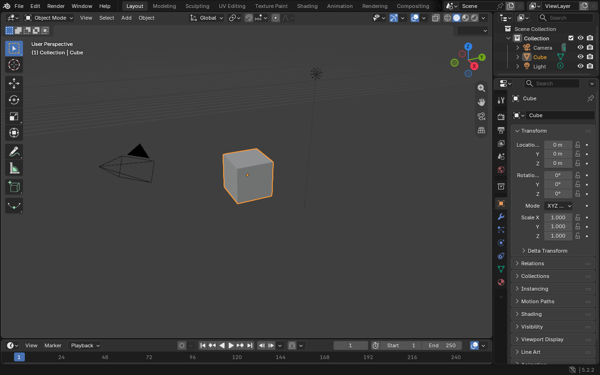

# Blender Web

Blender 5.2.2 LTS compiled to WebAssembly with its original C++ interface and a WebGPU backend.

[Open Blender Web](https://shlok-bhakta.github.io/blender-web/) · [Build instructions](web/native/README.md)

The browser build runs Blender's original editors, Python API, scene evaluation, and Workbench startup scene. After loading, the page contains only Blender's canvas. GHOST handles window size and display density; the WebGPU drawing buffers follow them. The initial target is desktop Chromium. Eevee renders the unchanged default cube scene at 1920×1080 and 64 samples. OpenSubdiv supplies CPU subdivision modeling. The build also includes GMP/Manifold Booleans, remeshing, UV SLIM, NumPy, FFTW oceans, Alembic scene exchange and Cycles CPU final rendering. Safari, mobile input, additional windows and Cycles GPU still need work.

Activate Emscripten 4.0.23, then build and serve:

```sh
python3 web/tools/native_build.py --app --jobs 8 --check-deps
python3 web/tools/serve.py --pages-mode
```

Open `http://localhost:8080`. GitHub Actions builds the original application, runs browser acceptance checks, and uploads build artifacts. A separate validated-release workflow verifies the packaged archive, runs deployment checks, and deploys the static files to GitHub Pages. The first visit downloads the application and runtime assets; a service worker caches versioned files and supplies cross-origin isolation for pthreads. User files use browser OPFS storage.

The `blender/` submodule pins the official stable release. Platform code lives in `intern/ghost/web/` and `web/native/`. Guarded patches in `web/patches/` connect it to upstream in an isolated build worktree, keeping the reference checkout clean. Native C++ uses optimization, SIMD, pthreads, and oneTBB.

[Watch modeling, offline save/reopen and Cycles CPU](web/docs/modeling-cycles-walkthrough.mp4) · [Feature coverage and checks](web/native/FEATURES.md)

[Watch native ocean animation and Alembic exchange](web/docs/ocean-alembic-walkthrough.mp4)

[Watch volumes and Mantaflow gas in the browser](web/docs/volume-walkthrough.mp4) · [Memory64 investigation](web/docs/memory64.md)

[Watch image codecs, SVG/PDF and Freestyle](web/docs/image-vector-freestyle-walkthrough.mp4) · [Dependency status](web/docs/dependency-status.json)

[Remaining dependency components](web/docs/dependency-components.md)

[Watch Embree acceleration in Cycles CPU](web/docs/embree-walkthrough.mp4) · [BVH2/Embree timings](web/docs/embree-performance.json)

[Watch CPU denoising and path guiding](web/docs/render-libraries-walkthrough.mp4)

[Watch audio stretching and AV1/HEVC exports](web/docs/media-walkthrough.mp4)

[Watch compressed glTF exchange and offline reopening](web/docs/gltf-walkthrough.mp4)

[Native versus browser performance and RAM measurements](web/docs/native-web-performance.md)

[Watch the first Eevee render](web/docs/eevee-default-scene.mp4) · [Render details and validation](web/docs/eevee-default-scene.md)



The older [platform fixture](web/README.md) remains available separately. Its JavaScript interface is not part of the native application.

Port code is GPL-2.0-or-later. Blender and dependencies retain their upstream licenses. Backend and recipe attribution is recorded in [THIRD_PARTY.md](web/native/THIRD_PARTY.md).
