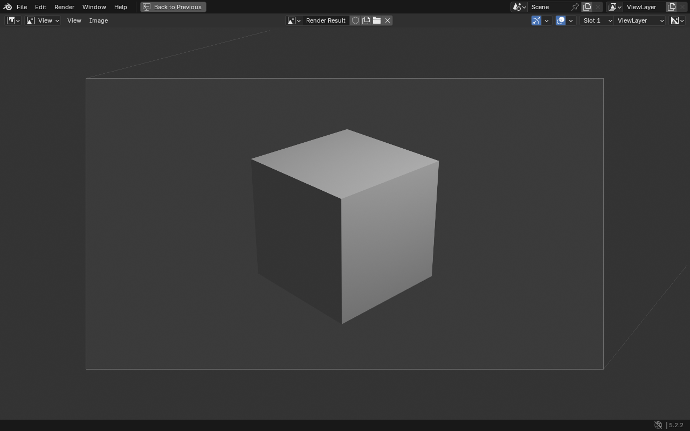
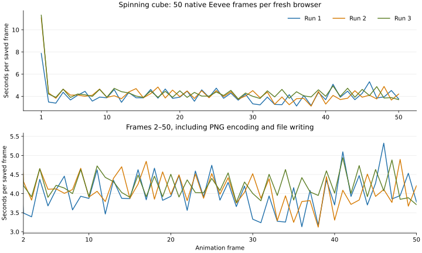

# First Eevee render in the browser

Blender's original Eevee engine renders the factory cube scene into its original
Render Result and Image Editor. The port also saves that result through Blender's
normal PNG writer and browser filesystem.

[Watch the browser recording](eevee-default-scene.mp4) · [Download Blender's rendered PNG](eevee-default-scene-render.png)



The recording shows three native Render → Render Image commands and the completed
images, including the first render and two repeat renders. It runs at normal speed. Startup and the Python validation commands are
trimmed from the clip.

The scene uses factory settings, including 1920×1080 at 100%, 64 Eevee samples,
the original Camera, Cube and Light, and AgX color management. The test compares
scene transforms, camera, light, color settings, frame, engine, resolution,
samples, and the render display preference before and after rendering. Nothing
in that snapshot changes. The one-canvas platform temporarily routes the render
display into Blender's existing full-screen Image Editor and restores the user's
window preference immediately afterward.

The current build completed a cold render in **11.60 seconds**, including
first-use shader compilation, in Chromium 145.0.7632.6 on Linux with an
AMD GCN 5 WebGPU adapter. Repeat renders in that session took
3.14 and 3.84 seconds. The saved PNG is 1920×1080 and fully opaque,
with 244,885 foreground pixels. Its decoded pixel channels match the previous
build's output exactly. The acceptance check recorded zero browser or WebGPU
validation errors. These are measurements on this machine; performance will vary.

## Render profiling and speed

A same-machine comparison with detailed profiling disabled measured the previous
build at **28.25 seconds** for a cold render and the current build at
**11.60 seconds**, a **2.4× speedup**. Repeat renders were GPU-bound and stayed
near three to four seconds in both builds. These are one cold run and two repeat
runs per build, with video capture enabled, rather than a statistical benchmark.
Both contexts started with an empty IndexedDB shader cache.

Separate Chromium traces recorded GPU submissions falling from **2,168 to 362**,
while preserving all 1,876 compute passes. Sampled render CPU time fell from
34.98 to 6.32 seconds. Shader adaptation accounted for 19.79 seconds of that CPU
time before the change and 0.67 seconds afterward. Tracing adds overhead; the
unprofiled timings above are the user-facing comparison. In the optimized repeat
render, Linux GPU busy samples averaged **85.74%** and peaked at **100%**.
The [performance evidence](eevee-performance.json) preserves timings, adapter,
CPU samples, API counts, asynchronous map waits, and the comparison method.

The browser profile identified repeated full-source regular-expression scans in
the WebGPU shader adapter as the largest CPU cost. The adapter now locates
literal prefixes before matching a declaration, and checks preprocessor
redefinitions by line. It preserves the translated shader input. Regression
checks compare expected output on both the host and Wasm, including large
shader sources, atomic buffers, clipping, and adjacent macro definitions.

Shaderc also now keeps one compiler per CPU worker. This preserves glslang's
built-in symbol cache between stages. The WebGPU backend batches compute passes
in the current command encoder and submits at sample boundaries, explicit
flushes, and upload/readback ordering boundaries. WebGPU pass boundaries retain
compute dependencies. The existing copy-on-write and in-place upload guards
remain active. `WGPU_SUBMIT_PER_DISPATCH` restores individual compute submissions
for debugging.

The initial pthread pool scales with the browser's logical CPU count, with two
extra workers and an eager-start limit of 64. Additional pthreads may still be
created. Device initialization already requests the high-performance adapter
and its supported resource limits. The site does not reduce samples or
resolution to gain speed.


## 50-frame spinning cube baseline

[Watch the rendered animation](spinning-cube.mp4) · [Interactive results](spinning-cube.html) ·
[Raw timings and resource evidence](spinning-cube.acceptance.json) · [Frame CSV](spinning-cube.frames.csv)

Three fresh Chromium processes each rendered frames 1 through 50 using Blender's
native Render Animation command. The factory cube rotates linearly around Z,
with keyframes at frame 1 and frame 51 for a complete turn. Resolution remains
1920×1080 at 100%, with 64 Eevee samples, the original camera and light, AgX,
and the factory PNG output settings. No frames or samples were skipped.

| Run | First saved PNG | All 50 frames | Output frames/sec | Device GPU busy, average |
| --- | ---: | ---: | ---: | ---: |
| 1 | 8.07 s | 179.70 s | 0.278 | 75.9% |
| 2 | 7.79 s | 179.84 s | 0.278 | 77.3% |
| 3 | 7.94 s | 178.72 s | 0.280 | 76.3% |

After waiting for the testing-glass T3 task to complete and its browser processes
to exit, the median first saved frame was **7.94 seconds**. The median 50-frame
time was **179.70 seconds**, or **0.278 output frames/sec**. All three sequence
times fall within 1.12 seconds.

| Median measurement | Earlier competing browser load | After that browser exited |
| --- | ---: | ---: |
| First saved frame | 11.08 s | 7.94 s |
| All 50 frames | 211.01 s | 179.70 s |
| Output frames/sec | 0.237 | 0.278 |

The sequence took **14.8% less time**, with **17.4% higher throughput**. This is
an observed comparison on the same shared machine, not a controlled experiment.
The runtime bundle and render settings are identical. The earlier
[interactive report](spinning-cube.shared-host.html),
[JSON](spinning-cube.shared-host.acceptance.json),
[CSV](spinning-cube.shared-host.frames.csv) and
[plot](spinning-cube.shared-host.frame-times.svg) remain available.

First-frame clocks run from Blender's `render_init` callback to the first
`render_post`, which runs after PNG encoding and writing in the animation path.
Keyboard-command-to-job delay is recorded separately. Startup, scene setup,
image export, validation and video encoding are excluded. PNGs are written to
the Wasm memory filesystem during timing. There is no screen recording or CPU
stack profiler in these runs. The output video plays those 50 frames at the
scene's factory 24 fps; it is a 2.08-second animation.



All **150 PNGs** passed size, foreground, alpha and frame-order checks. The
rotation curve advances by 7.2 degrees per frame. All 50 corresponding decoded
images match bit for bit across these runs and the earlier shared-load runs,
so the existing video also represents this output. There were zero browser or
WebGPU errors, and the checked quality settings remained unchanged.

A [five-second process CPU monitor](spinning-cube.host-load.jsonl) detected no
competing browser workload. The testing-glass thread began another turn during
run 3; its Claude process briefly reached 0.36 CPU cores. Other sampled
background processes peaked at 0.67 CPU cores each. Sampling began during run 1
after its first frame and can miss short-lived processes. These are low-load
shared-host measurements, rather than a claim of complete machine isolation.

Each run starts with an empty IndexedDB shader cache. OS and graphics-driver
caches are not cleared. Device-wide GPU busy time averaged 75.9% to 77.3% and
peaked at 100% in every run. Browser processes averaged 0.71 to 0.72 logical CPU
cores, with one-second peaks of 2.20 to 2.28 cores. Peak aggregate browser RSS
was 1.77 to 1.98 GiB. Device-wide GTT allocations peaked at 6.78 to 7.12 GiB and
fell to about 12 MiB after the benchmark browsers closed. These allocation
counters are not per-process resident-memory measurements.

Blender's normal UI loop pauses for this GPU-owner job. The first-frame metric
therefore measures saved output availability; the UI refreshes after the full
animation job. The report preserves both GPU readback and saved-PNG timing.
The [native build instructions](../native/README.md) include the repeatable
benchmark and report commands.


## Shared backend work

The render job runs on the browser worker that owns the WebGPU device. Blender's
CPU tasks still use oneTBB and the pthread pool. A guarded window-manager shim
schedules that job without passing worker-local JavaScript GPU handles to another
pthread. Emscripten's [JavaScript Promise Integration](https://emscripten.org/docs/porting/asyncify.html#jspi)
lets GPU readback wait without blocking the worker's JavaScript event loop.

Texture and framebuffer readback share a growable staging allocation, handle
WebGPU's row alignment, and convert half-float data into Blender's float Render
Result. The shader backend also handles explicit switch fallthrough, stage-specific
storage bindings, and multiple viewport transforms. Unsigned atomic array images
use real buffer atomics. Their samplers read the same backing buffer, avoiding a
full shadow-atlas copy between passes. The original shader files and Eevee
algorithms remain upstream code.

Translated shaders remain cached in IndexedDB. The application and runtime data
use versioned Cache Storage entries. Both the render bundle and a separate UI
bundle use optimized Wasm, SIMD, shared memory and pthreads. The loader chooses
the UI bundle when the browser lacks JSPI. It downloads only the selected
JS/Wasm pair; both variants share the same runtime data file.

These facilities live in GHOST, the WebGPU backend and dependency patches. Small
`WITH_GHOST_WEB` hooks connect them to the original render operators and jobs.
They provide common infrastructure for future Workbench and Cycles work; this
recording establishes Eevee's factory scene only. Cycles is still omitted from
the current lite build.

OpenImageIO also needs a Wasm-specific fix. Its private libc++ string-layout
shortcut corrupts interned metadata names longer than ten characters on this
SDK. The dependency patch selects ordinary string construction on Emscripten.
A regression test exports PNG with Blender's render metadata and verifies the
pixel round trip.

The checked scene and adapter capabilities are preserved in the
[acceptance report](eevee-default-scene.acceptance.json).

## Repeating the check

Build and serve using the [native build instructions](../native/README.md), then:

```sh
node web/tests/render.cjs
```

The test records Chromium, invokes the native Render menu, waits for GPU job
completion and successful 1920×1080 readback, saves a PNG with Blender, and
checks dimensions, opaque background and visible foreground. It rejects shader
translation failures, WebGPU validation errors and browser exceptions. Artifacts
and timing are written to `build/native/render-evidence/`.

For this first render, the adapter must expose `texture-formats-tier1`, at least
1024 compute invocations per workgroup, eight storage textures per shader stage,
and a storage-buffer binding larger than 512 MiB for the default atomic atlas.
Unsupported adapters get a native Blender error instead of starting Eevee.
Chromium's baseline SwiftShader adapter cannot meet these requirements. Browser
UI acceptance runs separately on that adapter, including a forced UI-bundle test,
resizing, native Python, persistent files and offline reload.

Desktop Chromium with hardware WebGPU and JSPI is the validated render target.
Safari rendering, additional windows, arbitrary scenes, all render passes,
blocking Python render calls, Workbench final renders and Cycles require further
work. The GPU job currently pauses the normal Blender UI loop, so interactive
progress updates and cancellation also need work. No quality settings were reduced to obtain this first image.
