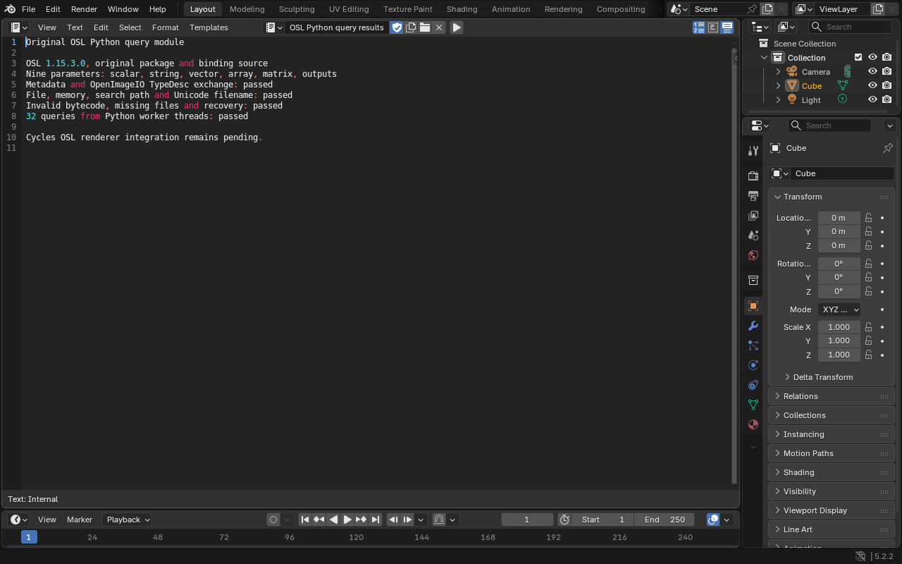
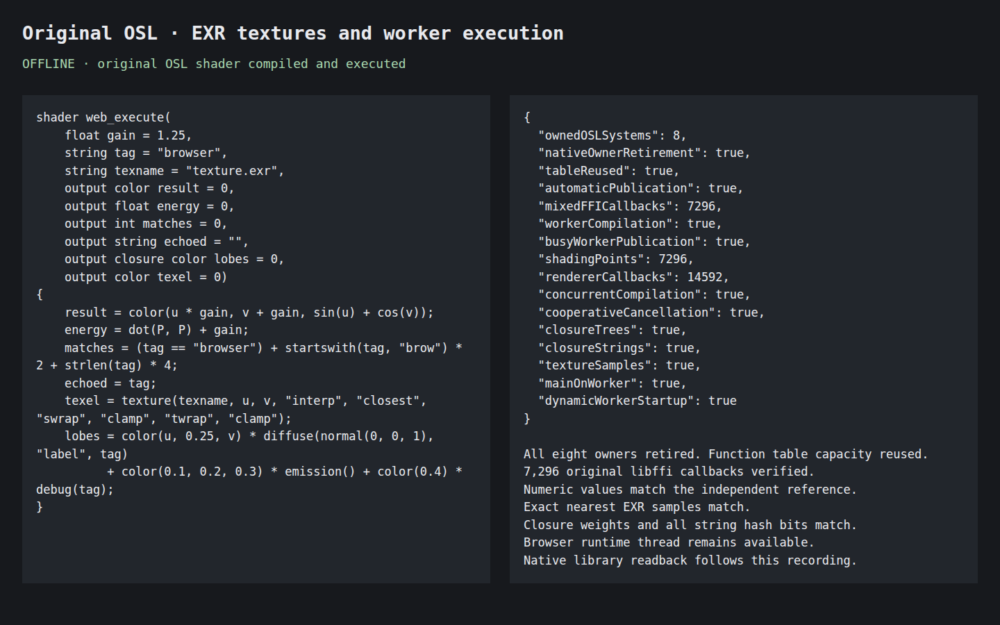

# Installed LLVM and OSL libraries

The dependency builder now installs Blender's pinned LLVM 20.1.8, Clang, LLD and
OSL 1.15.3.0. This adds two base recipes. The libraries, headers and CMake exports
are real upstream build outputs. LLVM's native tools generate matching helper
bitcode; its installed libraries target Wasm with pthreads, SIMD and Wasm
exceptions. The original `oslc` compiler also runs as a Node build command.

The [recorded checks](llvm-osl-installation.json) cover the installed libraries,
standalone browser execution and the original OSL Python query binding. These
checks do not enable Cycles OSL rendering in Blender.

LLVM compiled three modules and executed 4,096 integer, 64-bit integer, scalar
and SIMD cases per module in Node and offline Chromium. Invalid IR and failed
link recovery passed. OSL's installed compiler accepted valid input, rejected
invalid input and compiled valid input afterward. Its installed query library
matched native shader metadata across 128 queries on four workers, including
the full 64-bit string hash representation on wasm32.

The original `oslquery` Python module and package wrapper compile unchanged.
Its standalone interpreter check matched native Blender for all nine shader
parameters, defaults, metadata, shared OpenImageIO `TypeDesc` objects, Unicode
filenames, file and memory reads, error recovery and 32 queries from Python
worker threads. The original binding retains its GIL behavior. Both interpreter
checks use Blender's explicit UTF-8 preinitialization and require clean shutdown.
The existing image, color, volume and MaterialX binding checks also passed.

The application candidate `6fc613eabfc47ac917c2` includes this original query
module. Hardware Chromium and the fallback UI both passed the query checks,
saved a `.blend`, reloaded offline and queried the cached shader again. Native
Blender independently reopened both saved files and matched the query results.
The software-browser run passed the same checks and native readback. The
[application evidence](osl-python-integration.json) contains all three runs.
The query module adds 71,782 bytes to the main Wasm binary and 827 bytes to its
data package compared with the published `81aa3ca51ec1b21db65c` build. The LLVM
compiler and OSL execution libraries remain separate from the application.

[Watch the Blender application check](osl-python-walkthrough.mp4). This capture
shows the original UI, shader metadata queries and offline scene reopening.
Its [recording metadata](osl-python-recording.json) records the candidate and
artifact hashes. This candidate has not replaced the published build.



The installed OSL execution archive was separately linked with the existing
GHOST code owner and worker registry. Node and offline Chromium each shaded
7,296 points with closure trees, full string hashes and known EXR texture samples.
Each run made 14,592 renderer callbacks and 7,296 libffi callbacks. Concurrent
compilation, callback replacement, worker startup, cooperative cancellation and
native-owner cleanup passed. The emitted Node and browser shaders also passed
the independently verified native OSL library fixture.

[Watch the installed runtime check](osl-installed-runtime.mp4). This is an actual
standalone Chromium capture; application UI checks are separate.



The runtime fixture covers nearest EXR samples and fixed program layouts.
Broader texture operations, arbitrary table fragmentation, Cycles renderer
integration and heaps above wasm32's 4 GiB limit remain separate work.
The [JIT data-address check](jit-data-addresses.md) separately verifies global
lookup, relocations and out-of-order cleanup with the installed libraries.
Cancellation joins shader users before releasing their native owner; it does
not interrupt LLVM compilation or an individual shader instruction. The recipe
builds OSL's four exported libraries and two installed commands, excluding the
uninstalled BSDL lookup-table generator.

After building the other dependencies and activating the pinned SDK:

Install native `flex`, `bison` and `m4` before building OSL. Both source CI
workflows install these tools explicitly.

```sh
python3 web/tools/native_deps.py --jobs 4 LLVM OSL
python3 web/tools/native_compiler_check.py --jobs 2
python3 web/tools/native_bindings.py --jobs 4
python3 web/tools/native_osl_python_check.py --blender /path/to/blender
```

The optional `BLENDER_WEB_LLVM_HOST_BUILD` and `BLENDER_WEB_LLVM_WASM_BUILD`
variables permit reuse of a prior matching proof build. The builder checks its
source receipt, compiler version, SDK, target and ABI settings. A normal build
creates the tools and libraries from the pinned archive.
