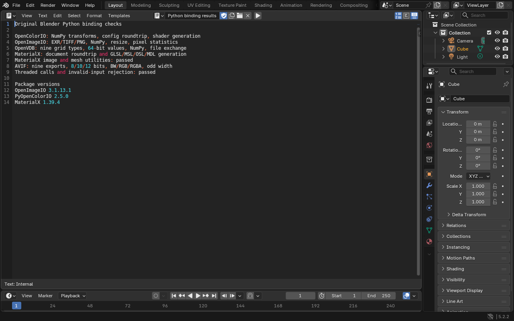

# Image, color, volume and material bindings

[Watch the browser recording](python-bindings-walkthrough.mp4).

Candidate `9d08b6bd9fd4bb9429db` passed these checks on hardware WebGPU, software
WebGPU and the fallback runtime. Each passed independent readback in native
Blender 5.2.2 LTS, including the saved `.blend`. Both source CI builds for runtime
commit `89179a7` passed, along with 97 local functional regression stages. The
performance pass overlapped unrelated host jobs and was discarded. The next
release combines these bindings with the [USD CPU plugins](usd-cpu-imaging-checks.md)
and requires a fresh 108-stage validation. Pages still serves
`8f28615dc99fd90616b7`. Candidate `9d08b6bd9fd4bb9429db` is retained as an
intermediate checkpoint, not a published release.

| Component | Tested operations |
| --- | --- |
| PyOpenColorIO 2.5.0 | Original package wrapper, NumPy CPU transforms, configuration roundtrip, GLSL source generation, invalid color-space rejection and nine threaded calls |
| OpenImageIO 3.1.13.1 | Original package wrapper, EXR/TIFF/PNG pixels, NumPy buffers, resize, statistics and nine threaded calls |
| OpenVDB | All nine native grid types, exact 64-bit integers above 53 bits, NumPy density arrays, file exchange, metadata, transforms, missing-grid rejection and twelve threaded calls |
| MaterialX 1.39.4 | Eight original extensions, document exchange, GLSL/MSL/OSL/MDL shader text, image/downsample/mesh utilities, invalid XML rejection and nine threaded calls |
| AVIF through libheif 1.20.2 and AOM | Nine original Blender exports covering 8/10/12 bits and BW/RGB/RGBA, 37-pixel byte/float inputs, independent native decoding, truncated-input rejection and decoder recovery |
| Persistence | The saved scene and volume reopen after an offline reload, preserving the exact 64-bit grid value |

The four MaterialX shader texts and the OpenColorIO shader text match the native
outputs exactly. Raw AVIF decoder pixels match native decoding. Blender's native
SSE power approximation differs from the browser by up to `0.000024081` in the
tested color conversions. A fresh native process disables only that approximation
and requires exact equality for all nine loaded pixel arrays. Native default
results remain in the verification report.

The standalone interpreter check runs all eleven extensions together and requires
clean Python finalization. The static link keeps MaterialX helper functions
distinct, supplies nanobind's exact Wasm constructor signature, and fixes the
guarded yaml-cpp shutdown callback. The Draco bridge also isolates its opaque
`Encoder` and `Decoder` types from libheif's global classes. A combined executable
reproduced the destructor collision before that fix and passes all nine AVIF
cases after it.

Shader generation does not supply an OSL compiler, a Cycles OSL runtime or the
MaterialX graphics renderers. General ctypes callbacks and the remaining USD,
Hydra and browser service gaps are separate work. Full dependency parity has
not been reached.

See the [recording metadata](python-bindings-recording.json),
[build and check instructions](../native/README.md) and
[component audit](dependency-components.md).

