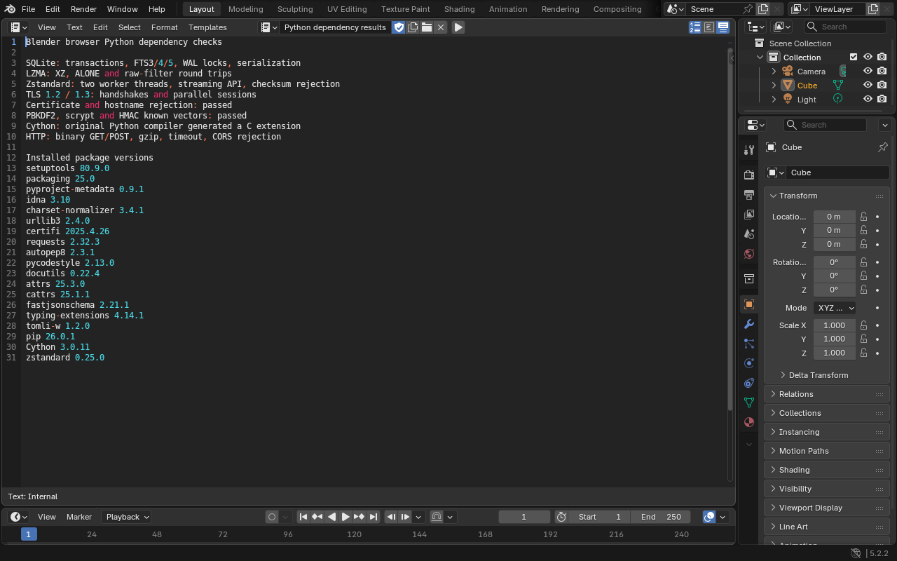

# Python dependency checks

[Watch the actual browser recording](python-foundation-walkthrough.mp4).

Published bundle `8f28615dc99fd90616b7` passed the Python foundation checks on
hardware WebGPU, software WebGPU and the fallback runtime. Each variant also
passed independent readback in native Blender 5.2.2 LTS. All 100 local application
regression stages and both source CI builds passed. All sixteen deployment groups
passed before publication. A fresh hardware run on the
[live Pages site](https://shlok-bhakta.github.io/blender-web/) passed the Python,
public HTTPS download and offline reopen checks, followed by independent native
readback. See the [live verification](python-foundation-live.json).

The recording has been refreshed from candidate `9d08b6bd9fd4bb9429db`, whose
foundation checks also passed all three runtime variants and native readback.
The next release combines the additional Python bindings, AVIF and USD CPU
plugins. Its production build and full 108-stage validation are pending.

| Added component | Verified operations |
| --- | --- |
| SQLite 3.51.3 | Transactions, rollback, Python callbacks, FTS3/4/5, RTREE, JSON, GEOPOLY, median, blobs, backup, serialization, WAL read isolation and writer locks |
| XZ/LZMA 5.2.5 | XZ, ALONE and raw filter formats, truncated input rejection and native file readback |
| OpenSSL 3.5.6 | Original CPython SSL/hash modules, TLS 1.2/1.3 memory-BIO handshakes, parallel sessions, certificate and hostname rejection, PBKDF2, scrypt and HMAC vectors |
| Python Zstandard 0.25.0 | Two compression workers, streaming API, checksum rejection and native file readback |
| Native Python runtime packages | Nineteen package versions match native Blender, including the sixteen locked pure Python distributions, bundled pip, Cython and Zstandard |
| Cython 3.0.11 | Original pure Python compiler generates C source for an authored extension |
| Browser HTTP | Binary GET/POST, custom headers, redirects, gzip, chunk iteration, 404, timeout, CORS rejection and recovery |
| Original Blender downloader | Conditional gzip download, ETag/304 reuse, metadata locking, two requests overlapping at the server, background callbacks and worker shutdown |
| Persistence | Database and compressed files survive an offline reload; native Blender opens the saved `.blend` and compares its proof text with the browser report |

The selected runtime is 414.49 MiB before transfer compression. The service
worker caches the selected runtime files by content hash. The existing fallback
selection and persistent OPFS filesystem also cover these Python packages.

The GHOST adapter runs HTTP on dedicated workers with the GIL released.
The browser controls TLS, CORS, redirects and restricted request headers.
Responses are buffered; chunk iteration does not stream from the network.
OpenSSL's separate TLS tests exercise its original memory-BIO APIs.

The downloader context implements the operations used by Blender's downloader
with threads and copied message channels. It does not supply general Python
multiprocessing or native subprocesses. Marketplace installation and cross-tab
metadata locking remain unverified. SQLite file mmap is disabled, and loading
SQLite extensions still needs dynamic Wasm linking. Cython's native accelerators
and loading its generated extensions remain pending. Full dependency parity
has not been reached.

See the [acceptance evidence](python-foundation.acceptance.json),
[recording metadata](python-foundation-recording.json),
[build and test instructions](../native/README.md) and
[remaining component audit](dependency-components.md).

