# Browser feature coverage

The application uses an explicit [web configuration](config.cmake), independent
of Blender's desktop lite preset. Features are restored and verified in
batches. The static site's
`manifest.json` records the actual CMake `buildOptions` for its binary.

| Feature | Configuration | Verification or remaining work |
| --- | --- | --- |
| Original editors, Python, Eevee, color management and image IO | Enabled | Original UI, Python, storage and default-scene render checks |
| Viewport picking | Enabled in JSPI bundle | Original mouse selection uses serialized JSPI frames for GPU readbacks |
| OBJ, STL and PLY | Enabled | Native cube export/import, geometry and bounds checks |
| FBX import | Enabled | Native ufbx importer, independently authored triangle fixture |
| Standard IK and iTaSC | Enabled | Two-bone chain follows two target positions with each solver |
| Bullet rigid bodies | Enabled | 100-frame fall and floor collision |
| Native `.blend` persistence | Enabled | Save physics scene to OPFS and reopen after browser reload |
| Device file picker, uploads and downloads | Deferred | Native file IO currently sees WasmFS; connect user-selected device files and exported results to browser APIs |
| Automatic `.blend` thumbnails | Deferred | Synchronous preview generation hangs outside a browser GPU job; a guarded GHOST save hook skips capture and restores the user's preview preference |
| NumPy and FBX Python exporter | Enabled | Static NumPy extensions, linear algebra, FFT, both random APIs, RNA array transfer and FBX export/native import round trip |
| Process-dependent add-ons and extension marketplace | Deferred | Native subprocesses, multiprocessing and arbitrary dynamic extensions are unavailable; the marketplace downloader currently reports a Python startup error |
| OpenSubdiv CPU | Enabled | Catmull-Clark cubes at levels 1–3, simple subdivision, open boundaries and native viewport drawing |
| OpenSubdiv GPU | Deferred | Patch-basis shaders and evaluator/draw validation for WebGPU; the platform selects CPU evaluation |
| GMP and Manifold Boolean solvers | Enabled | Both solvers: union, intersection and difference with volume, bounds and closed-mesh checks |
| Octree remeshing, QuadriFlow and UV SLIM | Enabled | Smooth/sharp remesh, closed quad topology and minimum-stretch UV unwrap |
| FFTW and Ocean modifier | Enabled | Float/double pthread FFT checks; native ocean animation, foam and UVs compared with desktop at three frames |
| Alembic scene exchange | Enabled | Ogawa animation in both directions with desktop Blender, mesh deformation, UVs, parent transforms and persistent offline reopen |
| OpenVDB and NanoVDB | Enabled | Float sphere grids, ZIP/Blosc file exchange, NanoVDB values and original mesh/volume modifiers |
| Mantaflow gas simulation | Enabled | Four frames at resolution 16, density grids compared with desktop and OpenVDB cache output |
| WebP, JPEG 2000, Cineon and DPX | Enabled | Small-file read/write compared with desktop; WebP lossless, JP2 16-bit, Cineon 10-bit and DPX 16-bit |
| Grease Pencil SVG/PDF | Enabled | Authored SVG import, SVG export/reimport, desktop exchange and independent PDF rasterization |
| Potrace image tracing | Enabled | Original image-to-Grease-Pencil operator, stroke geometry compared with desktop |
| Freestyle contour rendering | Enabled in JSPI bundle | Cycles CPU cube with red contour strokes, saved pixels compared with desktop |
| USD scene exchange and MaterialX graph export | Enabled | USDA/USDC/USDZ exchange with desktop, animation, UVs, cameras/lights, world textures, Python hooks and eight implicit shape fixtures |
| Hydra rendering and MaterialX Python bindings | Deferred | CPU imaging adapters supply shape geometry; native Hydra graphics devices are disabled |
| Audio/video IO and Video Sequencer | Enabled | WAV/FLAC/Ogg/MP3 and MKV/MP4/WebM inputs, video seeking, original audio and H.264/AAC or VP9/Opus video exports compared with desktop |
| Browser audio playback | Enabled | Original Audaspace mixer feeds a shared PCM ring and AudioWorklet; stereo playback, timeline advancement, captured output and offline reopen |
| Audio time stretching and pitch shifting | Implemented, tested | Rubber Band with FFTW, original Audaspace APIs, independent duration and stereo pitch checks |
| AV1 and HEVC encoding | Implemented, tested | libaom and 8-bit x265 through original Blender FFmpeg exports; native decode comparison |
| Audio input and multichannel devices | Deferred | Microphone capture and multichannel device integration |
| Cycles CPU final render | Enabled in JSPI bundle | 128×128, 16-sample factory cube compared with the pinned desktop release |
| Cycles progressive display and rendered viewport | Deferred | CPU final renders publish the completed Render Result; live display still needs browser-safe Python/GPU waits |
| Cycles GPU, denoising and OSL | Deferred | Separate device/backend and compiler work; Eevee WebGPU does not supply a Cycles device |
| Tracking and camera solving | Enabled for tested cases | Original libmv tracking of twelve translated frames and camera reconstruction from thirty-two synthetic point tracks; native readback and offline persistence |
| glTF Draco and meshoptimizer compression | Enabled for tested cases | Original codecs and add-on operators; Draco and EXT/KHR meshoptimizer exchange, UV/color/normal checks, morphs and animation, malformed-file recovery, desktop readback and offline persistence |
| Interface translation and saved language preferences | Enabled | All 49 original catalogs match desktop files; six language samples, French/Japanese UI and offline preference restoration |
| Unicode keyboard characters | Enabled | GHOST preserves complete one-scalar UTF-8 keyboard values, including four-byte characters; original Text Editor save/reopen |
| HarfBuzz and FriBidi | Library ports verified | Arabic/Devanagari shaping and mixed-direction ordering checks; this pinned Blender font renderer does not call these libraries |
| Full text shaping and IME composition | Deferred | Native renderer integration and browser composition input are separate work |
| Additional windows, NDOF devices and XR | Deferred | Browser platform/device integration |

GMP 6.3.0, Manifold 3.5.2 and NumPy 2.3.4 follow the pinned release's
versions and checksums. NumPy uses its original numeric code as static CPython
extensions. Its linear algebra build uses bundled routines without BLAS.
The shared Wasm SIMD and pthread settings also apply to these libraries.

Cycles uses its CPU kernels and worker pool. Native CUDA, HIP, Metal and oneAPI
devices are disabled. Eevee's WebGPU backend does not supply a Cycles GPU device.
The session controller stays on the UI worker, which owns browser GPU handles.
CPU final renders write through Blender's original output driver, then the Image
Editor displays the completed result. Progressive GPU display is disabled because
CPython's JavaScript function-call trampoline cannot suspend for GPU waits.
Selecting a Cycles rendered viewport reports an unsupported-mode error.
The WebGPU binding adapter also handles the final single-level mipmap dispatch.
Blender binds its unused second output to the first output's texture; WebGPU
requires distinct writable bindings, so the adapter supplies unused storage for
that second output. The 128-pixel Cycles Image Editor check exercises this case.

High-bit-depth x265, additional codec backends and audio input remain follow-up work. Device
file selection and download/export integration remain separate from the persistent
browser filesystem.

The [dependency status report](../docs/dependency-status.json) compares the actual
desktop and browser `bpy.app.build_options` values and lists the base library
recipes. These coarse flags are not a feature-parity percentage. OSL,
denoising and GPU evaluators also need renderer integration. Desktop JACK,
PulseAudio and OpenAL drivers are not browser audio backends. The web build uses
Web Audio for stereo output; NDOF, XR and additional audio devices need platform
integration.

Tracking uses Blender's original libmv code, bundled gflags/glog, pinned Abseil
20250814.1 and the release's pinned Ceres commit. Ceres retains its Eigen dense
and sparse solvers and pthread execution. CUDA, SuiteSparse and LAPACK are
disabled. A separate dependency check recovers known camera offsets using
dense QR and Eigen sparse normal Cholesky with up to eight available solver threads.

The browser check tracks a deterministic textured patch moving two horizontal
and one vertical pixel per frame across twelve 256x192 images. It compares
coordinates with desktop Blender and known motion. A second case solves twelve
cameras and thirty-two non-coplanar points from exact projected observations.
Both cases use original operators, persist in a `.blend` file, reopen offline
and are independently read back by native Blender. Real footage, automatic
feature detection, lens refinement, object/tripod solves and long clips are
not established by these small cases.

[Watch tracking and camera reconstruction](../docs/tracking-walkthrough.mp4).

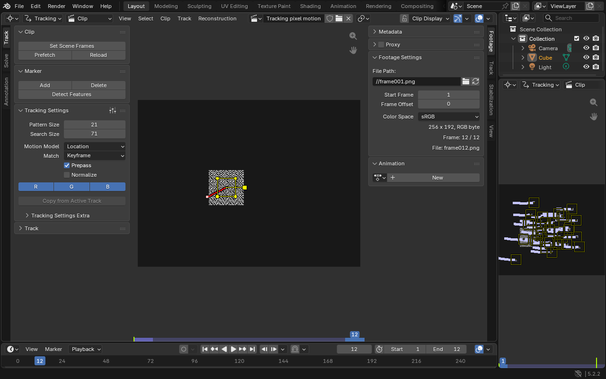

HarfBuzz 10.0.1 and FriBidi 1.0.12 use Blender's pinned archives and checksums.
The Wasm library checks shape Arabic and Devanagari through the original
OpenType shapers and reorder mixed Latin/Hebrew text through FriBidi. Blender's
current font renderer does not consume these dependencies, so their presence
does not establish full shaping in the interface. Font drawing retains the
same behavior as native Blender, including its current limitations.

The application enables the original translation system and packages all 49
catalogs produced by Blender's original `msgfmt` executable, run under Node.
All catalog bytes are compared with the same desktop release. Sample strings
cover English, French, Spanish, Japanese, simplified Chinese and Russian.
A guarded GHOST helper preserves the reader's signed string indices on wasm32;
converting a missing context delimiter to 32-bit `size_t` otherwise prevents
context-free catalog entries from matching.
Four font samples compare Latin accents, CJK, Devanagari and Arabic dimensions
and software-drawn pixels with desktop Blender. The GHOST keyboard check sends
trusted browser key events into the original Text Editor, saves the Unicode
text in a `.blend` file and reopens it offline. This covers one Unicode scalar
per keyboard event; dead-key composition and IME pre-edit/commit remain pending.
Saved preferences, including language, load from the persistent browser home
at startup. The startup scene still uses Blender's factory scene.

[Watch the translation and Unicode browser recording](../docs/text-translation-walkthrough.mp4).

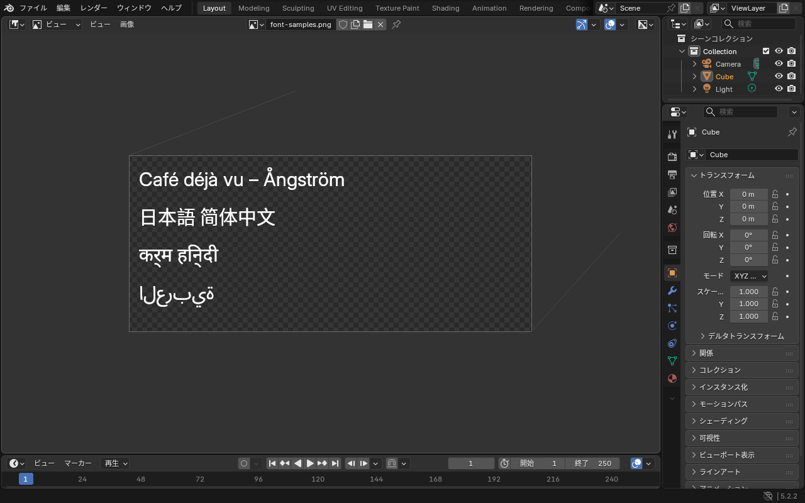

OpenUSD 26.03 and MaterialX 1.39.4 use the pinned release archives. The browser
loads 32 original static `pxr` extension modules. Eight shape fixtures produce
383 vertices with the same coordinates as desktop Blender. Scene exchange checks
cover mesh animation, topology, UVs, camera/light settings, decoded environment
textures and the original Python USD hooks, in both directions for USDA, USDC
and USDZ. Each browser variant repeats the exchange offline from OPFS.
MaterialX verification covers an exported OpenPBR graph and its base-color,
metalness and roughness inputs. The importer reads USD Preview Surface materials;
Hydra rendering and MaterialX's separate Python bindings remain disabled.

[Watch the USD and MaterialX browser recording](../docs/usd-materialx-walkthrough.mp4).
It shows the original UI, scene exchange, Blender's export menu and an offline
reload using the cached application and persistent USD files.

<!-- USD_RECORDING_CHAPTERS -->
| Time | What to inspect |
| --- | --- |
| 0:00 | Open original Blender with USD and MaterialX |
| 0:10 | Import native scenes; export USDA, USDC and USDZ with MaterialX and Python hooks |
| 0:25 | USD is available in Blender's original export menu |
| 0:34 | Reload offline and repeat interchange from persistent browser storage |
<!-- /USD_RECORDING_CHAPTERS -->

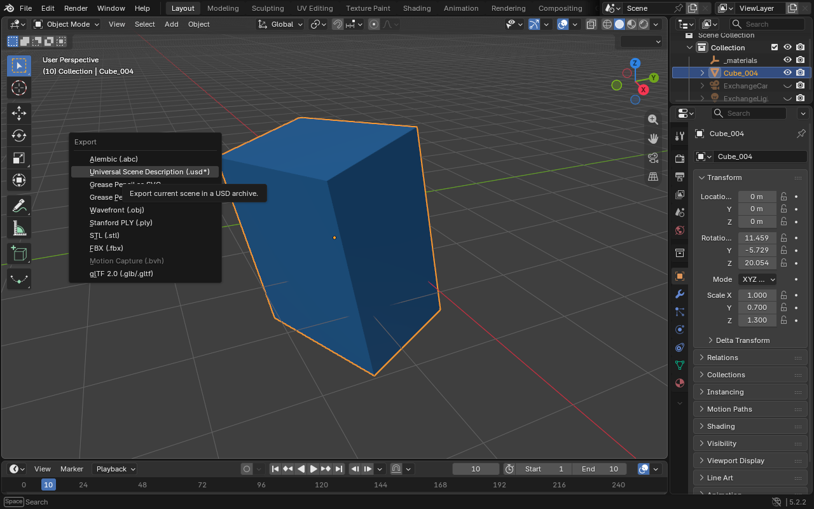

Release Wasm omits C++ function-name metadata. JavaScript API profiling, GPU
timestamps and external render timing remain available. A named C++ profiling
build can enable `BLENDER_WEB_DEBUG_NAMES`. The extra Binaryen inliner is disabled
after exceeding the build host's memory limit; Clang release optimization and the
remaining Binaryen `-O3` passes stay enabled. The native/browser measurements
cover this final configuration.

WebP 1.6.0, OpenJPEG 2.5.3, PugiXML 1.10, libharu 2.4.5 and Potrace 1.16
follow Blender's pinned archives and checksums. OpenImageIO is rebuilt with its
WebP and JPEG 2000 plugins, including the writer Blender uses for WebP. The
Blender Cineon/DPX wrappers and bundled Freestyle code remain unchanged.
The OpenImageIO DPX patch converts negative buffer-size markers to signed
64-bit values before multiplication, avoiding a nearly 4 GiB allocation on
32-bit Wasm. Grease Pencil reads its existing RGBA32 GPU buffer records
through read-only WebGPU storage bindings; other buffer-texture formats
still need implementation and validation. Grease Pencil viewport composition
requires the adapter's `dual-source-blending` feature. Hardware checks cover
drawing in both runtime variants. SwiftShader lacks that feature, so its
checks cover image/vector IO with the imported object hidden.
Image acceptance covers small files, not every format variant or large-image
capacity. Vector acceptance covers filled/stroked paths, a circle, single-image
tracing and one-frame SVG/PDF exports. Freestyle acceptance uses a 256-pixel,
16-sample Cycles CPU cube; other style modules and production scenes are untested.

[Watch the image, vector and Freestyle recording](../docs/image-vector-freestyle-walkthrough.mp4).

OpenVDB and NanoVDB 13.0.0 use Blender's pinned source archive, with the existing
TBB and compression libraries plus Blosc 1.21.1. Delayed loading is disabled,
as in Blender's desktop dependency recipe. The separate OpenVDB Python module
is not built. Blender's volume objects, modifiers and bundled Mantaflow solver
use the original C++ libraries. Acceptance does not establish liquid simulation,
noise/upres, long bakes or large production volume capacity.

The volume check reads Wasm-created ZIP and Blosc VDB files in desktop Blender,
then compares the browser's geometry against that reference. It also evaluates
Mesh to Volume followed by Volume to Mesh. The gas check compares every density
cell over four frames, with a fresh cache directory on every run. Both runtime
variants reopen VDB fixtures from OPFS after an offline reload.

[Watch the volume browser recording](../docs/volume-walkthrough.mp4).

<!-- VOLUME_RECORDING_CHAPTERS -->
| Time | What to inspect |
| --- | --- |
| 0:00 | Start Blender with OpenVDB and NanoVDB |
| 0:13 | Compare VDB import and volume modifiers with desktop Blender |
| 0:17 | Mesh to Volume and Volume to Mesh in the original viewport |
| 0:23 | Replay the four-frame Mantaflow gas simulation in Blender |
| 0:32 | Reload offline and reopen the VDB files from browser storage |
<!-- /VOLUME_RECORDING_CHAPTERS -->

The [memory64 investigation](../docs/memory64.md) records a standalone shared
heap probe above 4 GiB and the requirements for migrating the production ABI.
The published Blender application still uses wasm32.

FFTW 3.3.10 builds its original float and double libraries with pthread support.
The Ocean modifier uses Blender's original simulation and evaluation code.
Alembic 1.8.3 uses the original Ogawa archive implementation and the existing
Imath dependency. Neither feature needs an upstream algorithm patch.
HDF5 archives, ocean disk-cache baking and other Alembic schema types remain
outside this acceptance check. The tested ocean has 676 vertices and 625 faces,
with animation samples at frames 1, 6 and 12. Coordinate and UV comparisons
use an absolute tolerance of 0.0002 against the same pinned desktop release.

[Watch the ocean and Alembic browser recording](../docs/ocean-alembic-walkthrough.mp4).
It shows the cached ocean in Blender's viewport, timeline scrubbing, then an
offline reload and reopening the same animation from OPFS.

<!-- OCEAN_RECORDING_CHAPTERS -->
| Time | What to inspect |
| --- | --- |
| 0:00 | Blender starts with FFTW ocean simulation and Alembic enabled |
| 0:16 | Check ocean waves and exchange animated Alembic files with desktop Blender |
| 0:21 | Alembic ocean cache in the original Blender viewport |
| 0:31 | Scrub the cached animation from frame 1 through frame 12 |
| 0:39 | Reload offline and reopen the Alembic cache from persistent browser storage |
<!-- /OCEAN_RECORDING_CHAPTERS -->

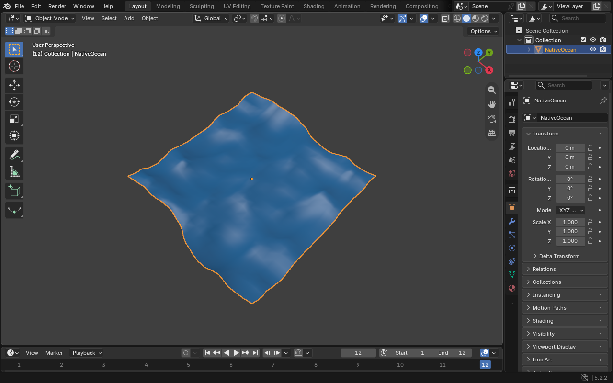

Run
`node web/tests/ocean-alembic.cjs` for the render variant,
`WEB_TEST_UI_FALLBACK=1 node web/tests/ocean-alembic.cjs` for the fallback,
and `WEB_TEST_HARDWARE=1 node web/tests/ocean-alembic.cjs` for hardware capture.
The fixtures and desktop regeneration command live in
`web/tests/fixtures/ocean-alembic/README.txt`. To verify a browser export in the
pinned desktop executable, run:

```sh
blender -b --factory-startup --python-exit-code 1 \
  --python web/tests/verify_ocean_desktop.py -- build/native/ocean-evidence-hardware
```

The restored Bullet, IK and importer code is already part of the pinned Blender
source. It compiles with the existing Wasm SIMD, pthread and exception settings.
No feature-specific edits to upstream algorithms are required for this group.
The save hook temporarily disables automatic preview capture, which the browser
UI cannot synchronously complete. Native scene serialization, overwrite backups
and persistent storage use Blender's writer. The integration check saves twice,
checks that the preview preference is restored, then reloads the browser and
opens the file again.
Shared platform and GPU adapters remain in GHOST and the WebGPU backend.

Run `node web/tests/features.cjs` against the locally served application. It
writes the native Python results, browser log and screenshots to
`build/native/feature-evidence`. Repeat with `WEB_TEST_UI_FALLBACK=1` to exercise
the bundle without JSPI; its results go to `build/native/feature-evidence-ui`.
Compilation alone does not establish runtime coverage for arbitrary production files, rigs or simulations.
Set `WEB_FEATURE_PROFILE=1` to capture a Chromium V8 CPU trace in the evidence
directory while diagnosing a stalled operation.


[Watch the browser walkthrough](../docs/modeling-cycles-walkthrough.mp4).
It shows both Boolean solvers cutting a cylinder through a cube, QuadriFlow's
quad edges, a NumPy-generated wave, saving that wave as a native `.blend`,
reloading offline and reopening it, then a Cycles CPU render.

<!-- WEB_RECORDING_CHAPTERS -->
| Time | What to inspect |
| --- | --- |
| 0:00 | Loading Blender; runtime files are cached for later visits |
| 0:23 | Original Blender UI and default cube |
| 0:31 | GMP exact Boolean: cylinder cut through a cube |
| 0:39 | Manifold Boolean: the same cylinder cut |
| 0:46 | Native QuadriFlow remeshing: visible quad edges |
| 0:52 | NumPy builds a 1,600-vertex wave inside Blender |
| 0:59 | Save a native .blend file to persistent browser storage |
| 1:03 | Offline reload: cached Blender starts with no network |
| 1:18 | Reopen the saved NumPy wave after an offline reload |
| 1:30 | Cycles CPU render: 128 x 128, 16 samples. Checked against desktop Blender. |
<!-- /WEB_RECORDING_CHAPTERS -->

The [acceptance report](../docs/web-features.acceptance.json) records the tested
bundle, exact runtime hashes, browser adapters, modeling results, rendering
comparisons and recording checksum. Its build uses the original pinned Blender
5.2.2 release. Both render and fallback UI bundles exercise native import/export,
FBX round trips, IK, Bullet, subdivision, Booleans, remeshing, UV SLIM, NumPy and
save/reopen. The render bundle also runs those operations on the AMD adapter.
Its `oceanAlembic` section contains the three browser variants and the independent
desktop check of the browser's exported animation. The `usdMaterialX` section records the USD variants, independent desktop
readback and its browser walkthrough. Each dependency batch retains its own
recording; the modeling/Cycles walkthrough above documents an earlier batch.

Resize checks cover rapid changes, zero-height recovery and display densities
of 1, 1.25 and 2. They compare GHOST's logical window size, Blender's editor
bounds and UI scale, and WebGPU backbuffer sizes. Each resize must draw the cube
before further input. The page contains only Blender's canvas after startup.

The hardware Eevee check uses the factory 1920×1080, 64-sample scene, starts at
2× display density and changes window size during the GPU job. Its saved PNG is
compared pixel for pixel with the earlier reference. The Cycles CPU check uses
128×128, 16 samples, seed 0, with denoising and adaptive sampling disabled. Its
saved PNG is compared with the same settings in desktop Blender 5.2.2. These are
functional checks; host activity makes their timings unsuitable as an isolated
performance benchmark.

The selected runtime is about 227.5 MiB before HTTP compression, including
Python, NumPy and Blender's data. Only one browser variant downloads. The two
variants currently have identical Wasm bytes, so their content-hash cache entry
can also be shared. The [cache report](../docs/loading-cache.acceptance.json)
checks cold, warm, offline and browser-restart offline startup for both variants.

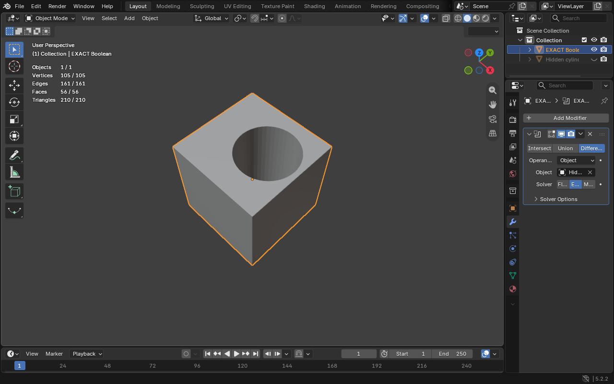

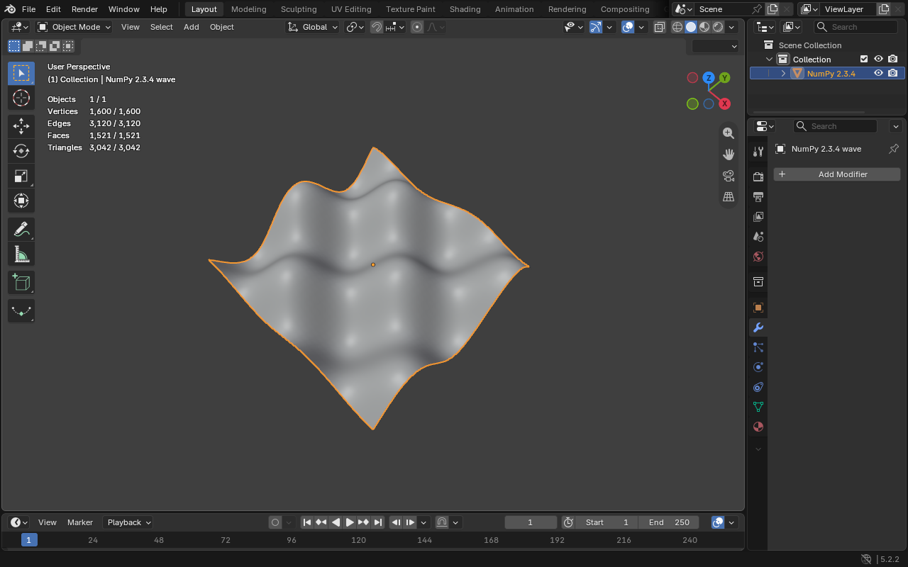

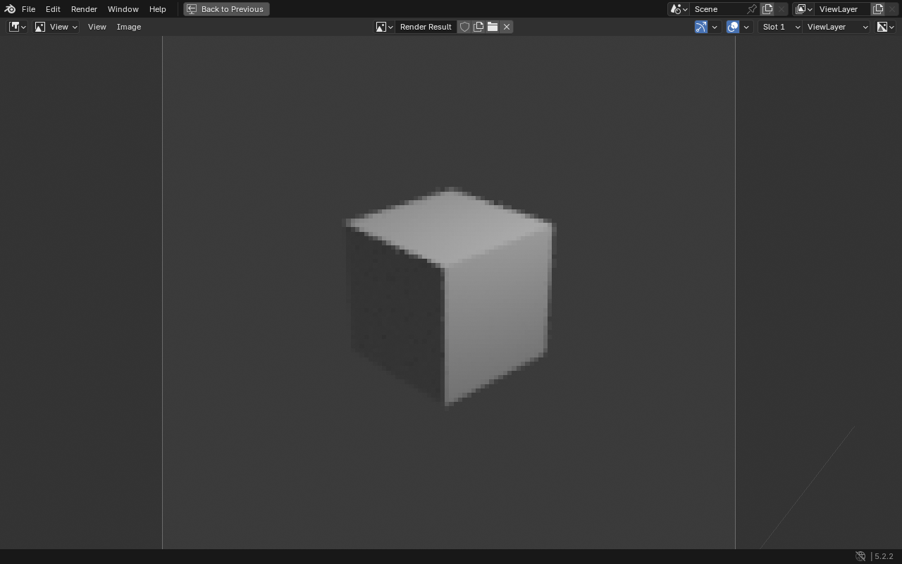

OpenSubdiv uses the release's pinned dependency and original CPU evaluator.
The upstream edits add a guarded GHOST capability call and omit unused OpenGL
includes for the web build. GHOST reports CSS window bounds and native pixel
density, while its acquire hook sizes GPU buffers before each draw. The WebGPU
backend releases cached bind groups and alias snapshots when buffers change size
and when their context is disposed.

Validation uses desktop Chromium with the repository's WebGPU launch flags.
Other browsers and mobile devices still need validation. Remaining dependency
and integration work is listed in the matrix above.

The [media recording](../docs/media-walkthrough.mp4) includes actual browser
audio and the original Video Sequencer. The [media benchmark](../docs/media-performance.json)
compares three native/browser runs on one-second clips and 24-frame 128×96
exports. Playback checks use a warmed preview and four sequential copies of the
clip. Timeline advancement under audio sync can skip displayed frames.

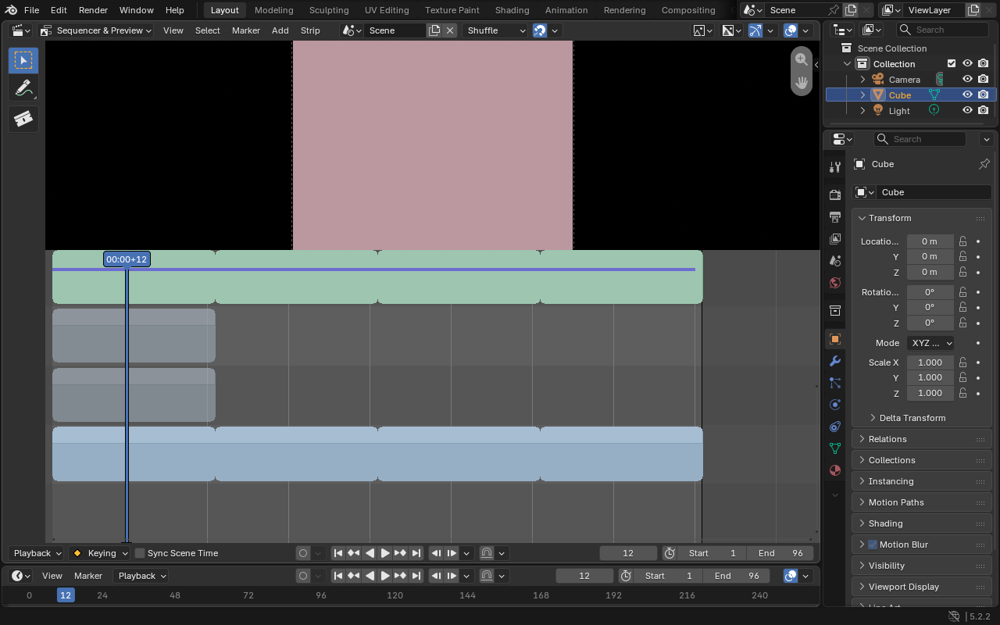

The [native/browser comparison](../docs/native-web-performance.md) records three
runs per workload on the same machine, including a 2.35-million-face CPU
subdivision case, ocean animation, Cycles CPU and the unchanged Eevee cube.
It separates CPU scene-memory growth from the larger browser baseline and
startup peaks. The configured Wasm32 heap limit remains 4 GiB; these checks do
not establish desktop-scale RAM parity or interactive viewport frame rate for
the largest evaluated mesh.

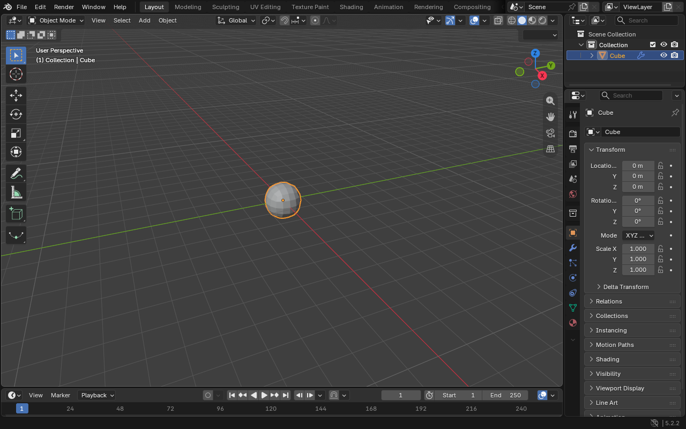

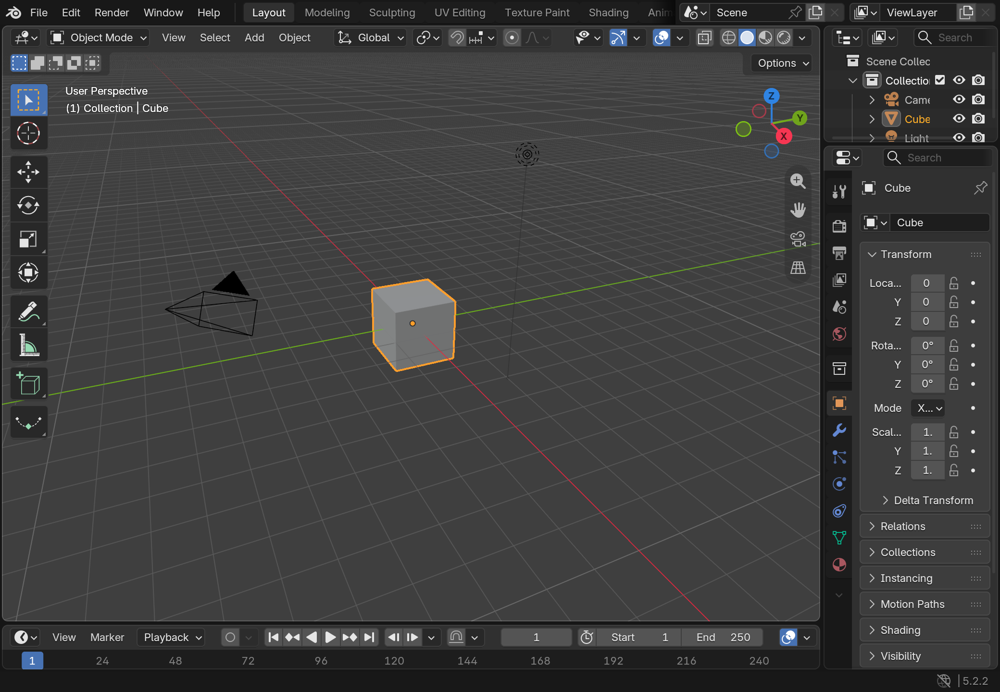

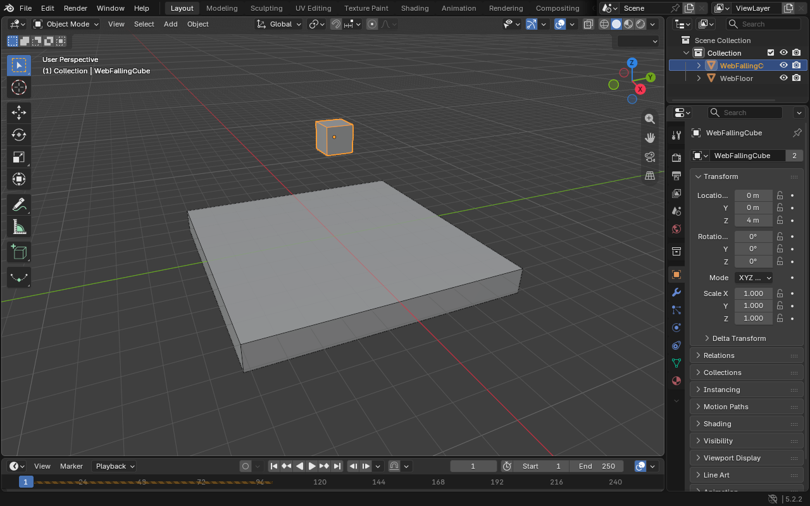

Draco 1.5.7 and meshoptimizer 1.1 link statically through a GHOST Python adapter.
The web hooks correct COLOR filter dispatch, sampled quaternion export stride,
and decoded placeholder lengths. The decoder also accepts the pinned desktop
exporter's older quaternion layout with explicit buffer bounds. New exports use
canonical eight-byte quaternion strides. Codec handles release automatically
when Python unwinds, and the adapter rejects invalid sizes, strides and writes
to read-only buffers before entering native codec functions.

The authored glTF checks cover one 528-triangle mesh with UVs, vertex colors,
normals, one morph target and animation, in three compression formats. They
also exercise the KHR COLOR filter with known values and reject three malformed
files before importing a valid asset in the same session. Skinning, external
compressed asset collections, large-scene stress tests and broader glTF
extension compatibility remain outside this coverage. See the
[recording](../docs/gltf-walkthrough.mp4) and [test source](../tests/gltf.py).
