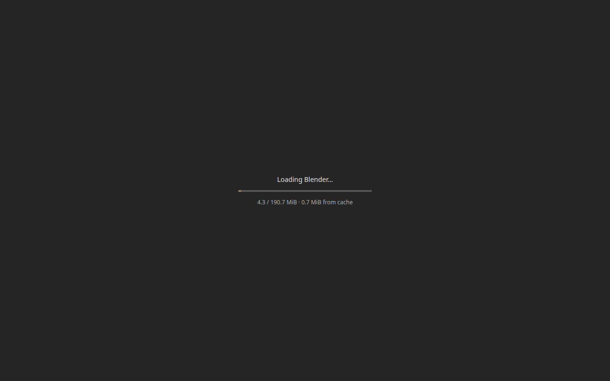

# Native Blender in the browser

This build uses the pinned official Blender release and its own top-level CMake
project. The executable contains Blender's original editors, window manager,
Python API, fonts, and startup scene. The separate `web/site` fixture remains
available for platform tests. The original interface and startup cube render through WebGPU in Chromium.

Activate the SDK pinned in `web/upstream.json`. Install CMake, a C/C++ host
compiler, Make, Ninja, pkg-config, Git LFS, Python 3, and uv, then run:

```sh
python3 web/tools/native_build.py --app --jobs 8 --check-deps
python3 web/tools/serve.py --directory build/native/dist --pages-mode --port 8093
```

The build defaults to one Binaryen optimization worker to avoid swapping while
linking the USD-enabled module. C++ compilation still uses `--jobs`; release
optimization and Blender's runtime workers are unaffected. Hosts with more RAM
can override this with `BINARYEN_CORES`. Release Wasm omits C++ function names
while preserving readable JavaScript. Set `BLENDER_WEB_DEBUG_NAMES=ON` in CMake
for named Wasm profiling on a host with enough memory. Binaryen 125's additional
whole-module inlining pass exceeds the available memory with the static USD
bindings, so it is disabled by default. Clang's release optimization and the
remaining Binaryen `-O3` passes stay enabled. Higher-memory hosts can opt into
that extra pass with `BLENDER_WEB_BINARYEN_INLINING=ON`.

Open `http://127.0.0.1:8093/`. The service worker supplies the isolation headers
needed by shared Wasm memory on a static host such as GitHub Pages. A first visit
reloads once after worker activation. WebGPU and browser workers are required.

`--skip-deps` resumes with the installed dependency libraries. `--configure-only`
stops after CMake generation. Without `--app`, the command builds the smaller
original editor archive checkpoint with Python and the GPU backend disabled.

Dependencies use the versions and source hashes from Blender's pinned release.
The application adds threaded CPython 3.13, static NumPy extensions, GMP,
Manifold, FFTW, Alembic, shaderc, SPIR-V Tools, and Tint. Their
recipes and pins are in `shader-deps/`. Source attribution is in
[THIRD_PARTY.md](THIRD_PARTY.md). Build logs and dependency reports are stored in
`build/native`; the dependency prefix is `build/native/deps/prefix`.

The browser runs Blender's C++ main loop on a pthread. GHOST receives keyboard,
mouse, wheel, and resize events from the canvas. A WebGPU backend translates
Blender's generated GLSL through shaderc and Tint into WGSL. The frontend is a
canvas and loading status; the editors are drawn by Blender itself.

The application uses an explicit web feature configuration, including native
OBJ/STL/PLY import/export, FBX import, both IK solvers and Bullet rigid bodies.
The [feature matrix](FEATURES.md) tracks enabled systems and remaining ports,
including Cycles CPU final rendering. Native C++ uses `-O3`, Wasm SIMD, pthreads, and Wasm exceptions.
oneTBB handles Blender's parallel tasks. The runtime sizes its initial pthread pool from the browser's reported logical
CPU count, plus two workers for platform work. It prestarts between four and 64
workers and permits additional pthreads when needed. Shared memory starts at 512 MiB and can
grow to 4 GiB, subject to browser and device limits. This first backend maps one
native window to one canvas; additional browser windows remain follow-up work.
Desktop Chromium is the initial validation target. iOS Safari needs device testing.

Cycles CPU builds use Embree 4.4.1 through its upstream Emscripten/SIMD path
and the existing oneTBB library. The original Cycles BVH2 path remains available
for paired tests. The [Embree recording](../docs/embree-walkthrough.mp4) shows
linked meshes, round curves, sphere points, transparency and motion blur.
The [timing report](../docs/embree-performance.json) compares three render runs
per backend within each binary and against native Blender. It uses a small
256×192 scene at 16 samples and eight CPU threads; it does not establish
large-scene performance or memory capacity. SYCL/GPU and ISPC paths are disabled.
The local paired baseline measured 1.177 s with BVH2 and 1.007 s with Embree,
a 1.17× speedup. Native Embree measured 0.556 s, putting this browser workload
at 1.81× native time. These are render/export medians, not viewport timings.
Native Blender also reopens and renders each browser-saved scene, with image
comparisons against the browser output or the native fixture.
The tiny factory-cube probe shows little backend difference: warm medians were
0.101 s with BVH2 and 0.097 s with Embree. The broader factory-cube baseline
measured 0.096 s browser versus 0.023 s native, or 4.10× native time. The
linked-scene speedup does not establish a general Cycles speedup.

```sh
PLAYWRIGHT_BROWSERS_PATH=/path/to/browsers WEB_TEST_HARDWARE=1 node web/tests/embree.cjs
python3 web/tools/native_embree_verify.py build/native/embree-evidence-hardware --blender /path/to/blender
```

The native image comparison requires host `ffmpeg` on `PATH`.

The test enables original Cycles logging and debug settings inside its isolated
browser context, and requires C++ logs to confirm the selected BVH. Production
startup does not enable those diagnostics. `WEB_EMBREE_BENCHMARK=1` and
`WEB_EMBREE_OUTPUT=build/native/embree-benchmark` disable recording for timings.
`WEB_EMBREE_PROFILE=1` captures a separate Chromium trace and resource counters.
For the separate cube probe, `web/tests/cycles.cjs` accepts `WEB_CYCLES_BVH=BVH2`
or `EMBREE`, verifies the backend in C++ logs, and retains first/warm render
times. Use `WEB_CYCLES_BENCHMARK=1`, `WEB_CYCLES_REPEATS=6` and a distinct
`WEB_CYCLES_OUTPUT` directory for each backend.

OpenPGL 0.7.1 path guiding and OIDN 2.5.0 CPU denoising use Blender's original
Cycles integration. The compositor's original Denoise node uses the same OIDN
library. [Watch the browser recording](../docs/render-libraries-walkthrough.mp4).
The authored scene covers surface and volume training, CPU denoising and the
compositor node, with independent native readback and offline reopening.
The [compiler bridge notes](oidn/README.md) explain generic ISPC SIMD compilation,
half precision and 32-bit size checks. Native GPU denoisers and OSL still need
separate work.

```sh
PLAYWRIGHT_BROWSERS_PATH=/path/to/browsers WEB_TEST_HARDWARE=1 node web/tests/render-libraries.cjs
python3 web/tools/native_render_libraries_verify.py build/native/render-libraries-evidence-hardware --blender /path/to/blender
```

FFmpeg, libsndfile and Blender's original Audaspace provide media decoding,
encoding and mixing. Rubber Band 4.0.0 uses FFTW for time stretching and
pitch shifting. libaom 3.13.1 and x265 4.1 provide AV1 and 8/10/12-bit HEVC encoding
through Blender's original FFmpeg output settings. The GHOST web audio device sends interleaved stereo PCM
from a mixer pthread to an AudioWorklet through shared memory. The browser
chooses the output sample rate; the device reports it to Audaspace for
resampling. A click or keypress resumes audio when autoplay policy requires it.
The worklet uses a versioned URL and is cached on startup for offline playback.
x264's automatic thread count uses the browser's logical CPU count.

The media checks use authored one-second stereo clips and 24-frame 128×96
videos, plus 512×512 AV1 exports to satisfy upstream tile sizing. They compare
decoded samples, metadata and seeks with desktop Blender,
export audio and movies through the original APIs, verify visible preview
pixels, and capture actual Web Audio output during sequencer playback. Host
FFmpeg independently reads the exports and checks the captured stereo tones.
The playback check warms the preview and plays four sequential copies of the
authored clip, so its three-second measurement runs within the timeline.
These checks do not establish large-timeline, microphone or multichannel
support. Time-stretch checks independently verify doubled and
halved durations with preserved stereo pitch, plus a separate 1.5× pitch shift.
Audaspace's real-time stretcher retains a short processing tail, matched against
the native result. The AV1 and HEVC exports are decoded by host FFmpeg and compared with native
Blender exports. The separate render-libraries check exports three-frame float gradients through Blender at 8/10/12 bits. Standalone lossless codec checks verify every sample at each depth with an independent host decoder.

```sh
PLAYWRIGHT_BROWSERS_PATH=/path/to/browsers WEB_TEST_HARDWARE=1 node web/tests/media.cjs
python3 web/tools/native_media_verify.py build/native/media-evidence-hardware
```

Use `WEB_TEST_UI_FALLBACK=1` for media IO and playback without final rendering.
Use `WEB_MEDIA_PROFILE=1` to capture a Chromium trace and resource counters.
For timing comparisons, use `WEB_MEDIA_BENCHMARK=1` with
`WEB_MEDIA_OUTPUT=build/native/media-benchmark` to disable screen recording;
`native_media_performance.py` compares three repetitions with the same native
Blender workload. The [media recording](../docs/media-walkthrough.mp4) includes
the captured browser audio. Its [chapter metadata](../docs/media-recording.json)
and [performance report](../docs/media-performance.json) describe the checks.

Runtime scripts, fonts, color-management data, and Python's standard library are
packaged into the preload data file. User files live under `/user/blender-web/home` in WasmFS's
OPFS backend. If persistent storage is unavailable, that session uses memory.

The application also packages all 49 original translation catalogs, generated
by Blender's `msgfmt` tool under Node. Saved language preferences load from
the persistent browser home. The GHOST keyboard path accepts complete UTF-8
characters from keyboard layouts. Browser IME composition remains pending.
HarfBuzz and FriBidi are built and tested as libraries; the pinned release's
font renderer does not yet use them. See the [coverage report](FEATURES.md)
and [translation recording](../docs/text-translation-walkthrough.mp4).

```sh
PLAYWRIGHT_BROWSERS_PATH=/path/to/browsers WEB_TEST_HARDWARE=1 node web/tests/text.cjs
WEB_TEST_UI_FALLBACK=1 node web/tests/text.cjs
```

The checks compare all catalog hashes and six language samples with native
Blender, compare four font samples, send trusted browser Unicode key events,
save/reopen the resulting text, and restore language preferences offline.
Library checks separately cover Arabic/Devanagari shaping and mixed-direction
ordering. Meson 1.9.0 and Ninja 1.13.2 run in an isolated build-tool environment.

Tracking uses the original libmv operators with pinned Abseil/Ceres and bundled
gflags/glog. The small fixtures cover twelve tracked frames and reconstruction
of twelve cameras from thirty-two points. Checks compare marker coordinates
and normalized camera motion with native Blender, then reopen the saved data
offline and in the desktop build. See the [tracking recording](../docs/tracking-walkthrough.mp4)
and [coverage limits](FEATURES.md).

```sh
WEB_TEST_HARDWARE=1 node web/tests/tracking.cjs
python3 web/tools/native_tracking_verify.py build/native/tracking-evidence-hardware --blender /path/to/blender
WEB_TEST_UI_FALLBACK=1 node web/tests/tracking.cjs
```

The glTF add-on links Draco and meshoptimizer through static Python calls in
GHOST. It keeps Blender's original C++ codec bridges and Python import/export
logic. The adapter passes Python buffers instead of integer memory addresses,
retains their lifetime during each call, and returns immutable Draco output
bytes. This is specific to these codecs and does not enable arbitrary shared
libraries. The separate [original ctypes integration](../docs/ctypes-integration.md)
adds registered process symbols and worker callbacks; its release validation
is tracked there.

The adapter also corrects the pinned add-on's COLOR decoder dispatch and its
sampled-object quaternion export stride. New compressed buffer views match
the decoded count and stride, as required by the
[meshoptimizer extension](https://github.com/KhronosGroup/glTF/blob/main/extensions/2.0/Vendor/EXT_meshopt_compression/README.md#json-schema-updates).
A bounded decoder path accepts the pinned desktop exporter's older quaternion
layout. Native reference generation zeroes that exporter's unused allocation
padding. Stored input hashes identify the exact fixtures; comparisons use
geometry and attribute tolerances rather than requiring repeat exports to have
identical compressed bytes.

The glTF checks exchange authored Draco, EXT meshoptimizer and KHR meshoptimizer
GLBs with desktop Blender. They cover 528 triangles, UVs, colors, normals,
a shape key and animation, with offline `.blend` reopen. Library checks also
exercise both index modes, the original filters and the KHR color filter, truncated input,
invalid dimensions, write access and codec-handle cleanup. Skinning, external
compressed asset collections and large-scene stress testing remain follow-up
coverage. See the [recording](../docs/gltf-walkthrough.mp4).

```sh
WEB_TEST_HARDWARE=1 node web/tests/gltf.cjs
python3 web/tools/native_gltf_verify.py build/native/gltf-evidence-hardware --blender /path/to/blender
WEB_TEST_UI_FALLBACK=1 node web/tests/gltf.cjs
```

For Python-only development, `WEB_GLTF_PYTHON_OVERLAY=1` injects the current
adapter and guarded exporter files into a test session while the package links.
Release acceptance rejects runs with this overlay enabled.

The loader shows byte progress for the selected JS/Wasm/data bundle, including
bytes reused from cache. After downloading it shows startup status until the
first Blender frame, then removes the loading overlay completely. Sizes are
uncompressed runtime bytes, not compressed network transfer sizes.

The service worker caches each complete runtime file in Cache Storage under its
SHA-256 content hash. Versioned request URLs keep a tab's code and data matched
across deployments; unchanged files reuse the same stored response even when a
new shell or another library changes the build version. Old tabs retain access
to their original cached files after a new worker activates. A cache write runs
alongside the response so Wasm streaming compilation can start immediately.
Only the selected render or fallback runtime is fetched. Interrupted files must
be fetched again; this does not yet resume downloads at arbitrary byte offsets.

Warm and offline reloads need no runtime asset network requests. Translated WGSL
is cached separately in IndexedDB, and user files use OPFS. The loader requests
persistent storage, but browsers can decline or evict site storage. If a runtime
cache write fails, the download still loads and the overlay reports that it
could not be saved. Existing version caches remain available; old content is not
yet automatically pruned. The first visit after upgrading from the previous
URL-based cache format downloads the selected runtime once.

Run `node web/tests/loading.cjs` for cold, warm, offline and browser-restart offline checks against
the native server. Set `WEB_TEST_UI_FALLBACK=1` to check the other runtime. Run
`node web/tests/cache.cjs` for a small deployment fixture that checks reuse across
versions, old-tab offline reads, changed-file downloads and quota failures.
The [startup/cache report](../docs/loading-cache.acceptance.json) records both
runtimes fetching four files on a cold start and zero runtime asset network
requests on warm and offline starts. Every start reached Blender's first frame.



All upstream changes live in guarded patch files in `web/patches/`. New platform,
GPU, startup, and build code lives under `intern/ghost/web` and `web/native`, then
is copied into an isolated source worktree. The reference submodule stays clean.
Small ABI helpers preserve 32-bit DNA record layout and ResourceScope's two-word
size invariant. Original DNA size and member-offset assertions stay enabled.
Image-cache keys retain 64-bit storage so runtime keys above `2^32` stay
distinct from render-slot hashes on Wasm32. A shader-scope shim normalizes invalid indices before signed 64-bit indices are
compared with Wasm32 `size_t`. The expression evaluator uses a per-thread software
math-error status because Wasm has no hardware floating-point exception flags.

`datatoc`, `makesdna`, `makesrna`, and `shader_tool` run as Wasm programs under Node with host
filesystem access confined to the build tools. This preserves target pointer
sizes and alignment during DNA generation. The shader regression check also builds a host executable and compares its
output with the Wasm processor.

The full regression runner records its packaged candidate and stage results.
After investigating a failed stage, resume it with
`python3 web/tools/native_validate.py --resume-from STAGE --blender /path/to/blender`.
Resuming requires the identical manifest and a successful recorded prefix; the
final acceptance checks still verify each report against the current sources.

The Python foundation adds the original CPython SQLite, LZMA, SSL and OpenSSL
hash modules, Python Zstandard, the pinned pure Python site packages and pip.
Cython runs its original Python compiler to generate C source. Its compiled
accelerators and arbitrary generated extension loading are separate work.

```sh
WEB_TEST_HARDWARE=1 node web/tests/python-foundation.cjs
node web/tests/python-foundation.cjs
WEB_TEST_UI_FALLBACK=1 node web/tests/python-foundation.cjs
python3 web/tools/native_python_verify.py build/native/python-foundation-evidence-hardware --blender /path/to/blender
python3 web/tools/native_python_recording.py
```

For a deployed HTTPS site, expose the synthetic fixture server through a public
HTTPS endpoint. Set `WEB_PYTHON_FIXTURE_PORT` to its local listening port and
`WEB_PYTHON_NETWORK_URL` to that endpoint, alongside `WEB_TEST_URL` and
`WEB_PYTHON_OUTPUT`. This avoids a public page requesting private localhost
access. The browser's CORS and local-network protections remain enabled.

These checks run through Blender's original console. They cover database
transactions, FTS3/4/5, WAL read isolation and writer locks, LZMA/Zstandard file
exchange, TLS 1.2/1.3 memory-BIO handshakes and certificate rejection, package
APIs and Cython code generation. Native Blender independently reads the saved
database, compressed files, HTTP outputs and `.blend`, and compares package
versions and SQLite compile options. SQLite file mmap is disabled for browser
storage; the other tested functional compile options match the native build.

Python HTTP runs on dedicated workers and uses synchronous worker XHR with the
GIL released. urllib3 keeps its original connection and response classes.
Responses are buffered; iterating response chunks does not stream from the
network. The browser controls TLS, redirects, CORS and restricted headers.
Blender's original conditional and background downloaders use guarded GHOST
hooks for decoded response lengths, thread workers, copied message channels
and metadata locks. This context only implements the downloader's operations.
It does not provide general multiprocessing, raw sockets or subprocesses.
Marketplace installation and cross-tab metadata locking remain unverified.

The image, color, volume and material binding build statically registers the
original OpenImageIO, PyOpenColorIO, OpenVDB, OSL query and eight MaterialX extension modules.
It preserves their Python package wrappers. MaterialX generates GLSL, MSL, OSL
and MDL source and supplies its core image and mesh utilities. Its OpenGL renderer
and OSL rendering compiler/runtime integration remain separate work.

```sh
python3 web/tools/native_bindings.py --jobs 4
WEB_TEST_HARDWARE=1 node web/tests/python-bindings.cjs
node web/tests/python-bindings.cjs
WEB_TEST_UI_FALLBACK=1 node web/tests/python-bindings.cjs
python3 web/tools/native_bindings_verify.py build/native/python-bindings-evidence-hardware --blender /path/to/blender
python3 web/tools/native_bindings_recording.py
```

These checks compare CPU color transforms, image pixels, all nine OpenVDB grid
types and four generated shader texts with native Blender. Integer values beyond
53 bits pass through JSON as decimal strings. AVIF checks use Blender's original
image API at 8, 10 and 12 bits in grayscale, RGB and RGBA. The 37-pixel width
covers odd-width byte input. Native Blender independently reads
the exported files and saved scene. Expected truncated-input errors are consumed
before checking decoder recovery.

Native AVIF readback records Blender's default color conversion. A second native
process disables only OpenColorIO's `OPTIMIZATION_FAST_LOG_EXP_POW` approximation
and requires exact equality with the browser's scalar color results. The report
retains the difference from native SSE defaults separately from codec errors.

The combined interpreter check exercises the image, color, volume and material
extensions in one process and requires clean Python finalization. The Wasm-only
nanobind patch supplies the
constructor callback's exact three-argument signature. Module-specific compiler
definitions keep MaterialX's internal helper names distinct when statically
linked. The guarded yaml-cpp value lifetime fix avoids an invalid shutdown
callback signature without changing its native build.

LLVM 20.1.8, Clang, LLD and OSL 1.15.3.0 now have pinned installation recipes.
LLVM's native tools generate build tables and matching helper bitcode; its
installed libraries target Wasm. `oslc` is the original compiler running in Node
and reads build inputs through Node's filesystem. Installed CMake packages refer
to real archives. The OSL build selects its four exported libraries and two
installed commands; its uninstalled BSDL table generator is separate.

The native Flex executable runs through a private launcher. OSL infers an
include directory from that executable's location; passing `/usr/bin/flex`
directly would add native `/usr/include` to the Wasm build. The private directory
contains only the original optional `FlexLexer.h`, keeping C and C++ headers in
the SDK. `web/tests/osl_parser_headers.py` reproduces that failure with a real
lexer and verifies the corrected wasm32 output.

Source CI checkpoints LLVM before compiling OSL. Its cache contains only the
files named by LLVM's genuine installation manifest, its companion Wasm tools,
and the native tool build tree. Restoration verifies every file and its source,
SDK and toolchain inputs before touching the dependency prefix. Other dependency
files are preserved. An OSL failure therefore does not discard LLVM's completed
build. The final compiler checks still execute the restored libraries.

The original `oslquery` Python package shares OpenImageIO's `TypeDesc` binding.
Its check covers shader defaults and metadata, file and memory queries, Unicode
paths, invalid input, recovery and calls from Python worker threads. Cycles OSL
rendering remains disabled until the renderer adapter is qualified.
See the [installation and application checks](../docs/llvm-osl-installation.md)
for native comparisons and recordings. Native `flex`, `bison` and `m4` are build
prerequisites for the original OSL parser.

```sh
# Activate the pinned SDK before running these build and interpreter checks.
python3 web/tools/native_deps.py --jobs 4 LLVM OSL
python3 web/tools/native_compiler_check.py --jobs 2
python3 web/tools/native_bindings.py --jobs 4
python3 web/tools/native_osl_python_check.py --blender /path/to/blender
WEB_TEST_HARDWARE=1 node web/tests/osl-python.cjs
WEB_TEST_UI_FALLBACK=1 node web/tests/osl-python.cjs
python3 web/tools/native_osl_python_verify.py build/native/osl-python-evidence-hardware --blender /path/to/blender
python3 web/tools/native_osl_python_recording.py
```

The browser fixture is bytecode produced by the earlier offline browser compiler
proof, with its checksum recorded in `web/docs/osl-compiler-probe.json`.
The installed compiler check also compiles fresh bytecode and compares its query
results with native Blender's metadata reference. These compiler and library
checks do not enable OSL rendering in Blender's browser application.

The standalone [JIT data-address check](../docs/jit-data-addresses.md) covers
global lookup, data/function pointer relocations, shared worker reads and
out-of-order native-owner retirement using the installed LLVM libraries:

```sh
python3 web/tools/native_jit_data_check.py --jobs 2
```

The [Cycles OSL ABI check](../docs/cycles-osl-abi.md) applies its guarded type
patch to a private header/source copy, compiles the three original OSL kernel
sources to wasm32, and checks closure layouts, full string hashes and texture
handle representation against native types. It keeps renderer integration
separate from these compilation checks.

```sh
python3 web/tools/native_cycles_osl_abi.py --blender /path/to/native/blender
```

The static Draco bridge gives its opaque `Encoder` and `Decoder` types web-specific
names so they cannot collide with libheif's global classes and destructors. Its
original C entry points stay intact. The AVIF regression executable links both
libraries, creates and releases both Draco objects, and exercises all nine codec
cases. The standalone glTF check uses the same type shim.

The dependency checks exercise actual oneTBB workers, exception propagation,
PNG round trips and error recovery through OpenImageIO, OpenColorIO, and Blender's
WOFF2 font through FreeType/Brotli. Application checks also run embedded Python
modules and Blender expression-evaluator error cases. Browser acceptance runs
with `node web/tests/native.cjs` against the static server and writes screenshots
and logs to `build/native/evidence`.

The browser acceptance check verifies original UI pixels, a real WebGPU device,
worker startup, canvas resizing, native Python Console execution, OPFS writes
that survive reload, and offline application startup from Cache Storage. Its
evidence files include screenshots and `acceptance.json`. This establishes the
startup path; it does not establish complete editor or renderer compatibility.
Remote asset downloads requiring subprocesses, extra windows, and Safari device
validation remain incomplete.


The [first Eevee render and recording](../docs/eevee-default-scene.md) use the
unchanged factory cube scene at 1920×1080 and 64 samples. The render variant uses
Emscripten JSPI for GPU readback waits. The build also links a UI variant without
JSPI, and the loader selects it when stack switching is unavailable. Rendering
on that variant reports an error through Blender. Its existence does not establish
Safari compatibility.

To repeat browser checks against the server above:

```sh
node web/tests/native.cjs
WEB_TEST_UI_FALLBACK=1 node web/tests/native.cjs
node web/tests/features.cjs
WEB_TEST_UI_FALLBACK=1 node web/tests/features.cjs
node web/tests/ocean-alembic.cjs
WEB_TEST_UI_FALLBACK=1 node web/tests/ocean-alembic.cjs
node web/tests/volume.cjs
WEB_TEST_UI_FALLBACK=1 node web/tests/volume.cjs
node web/tests/render.cjs
```

The render check needs a hardware WebGPU adapter with the capabilities described
in the render document. The UI checks use Chromium's software WebGPU adapter.
The render check records a browser video, saves the original Render Result as a
PNG, compares scene settings before and after, and fails on WebGPU validation or
shader translation errors. Outputs are in `build/native/render-evidence`.

The UI check also exercises rapid window resizing, canvas layout changes,
zero-sized canvas recovery, and display scales of 1, 1.25 and 2. It checks
GHOST's logical dimensions through native Python, the editors' physical pixel
bounds, and the WebGPU backbuffer sizes. The running page must contain only the
Blender canvas. Both render and fallback bundles run these checks in CI.
Set `WEB_TEST_HARDWARE=1` to repeat the UI/resize check with the hardware Vulkan
adapter and save its evidence in `build/native/evidence-hardware`.
The same setting runs `features.cjs` on hardware and writes
`build/native/feature-evidence-hardware`, including the subdivision viewport.
Set `WEB_RENDER_DEVICE_SCALE=2` to check startup, native Render menu input and
Eevee rendering on a high-DPI display. `WEB_RENDER_REFERENCE` accepts a saved
PNG and requires an exact match of decoded pixels.

`volume.cjs` checks OpenVDB/NanoVDB and a four-frame Mantaflow gas simulation
against the pinned desktop Blender release. Generate its small VDB fixtures with
the dependency checks, then run `python3 web/tools/verify_volume_desktop.py` with
`--blender` pointing to that desktop binary. The browser check also reloads
offline and reads VDB files from OPFS. Use `WEB_TEST_HARDWARE=1` for its hardware
recording, then `python3 web/tools/native_ocean_recording.py --kind volume` to
caption it.

`image-vector.cjs` checks image codecs, SVG import, Potrace, SVG/PDF export and
offline reopening. Generate its paired fixtures with desktop Blender:

```sh
blender -b --factory-startup --python-exit-code 1 --python-expr "import runpy; runpy.run_path('web/tests/image_vector.py')['fixtures']('web/tests/fixtures/image-vector')"
node web/tests/image-vector.cjs
WEB_TEST_UI_FALLBACK=1 node web/tests/image-vector.cjs
WEB_TEST_HARDWARE=1 node web/tests/image-vector.cjs
blender -b --factory-startup --python-exit-code 1 --python web/tests/verify_image_vector_desktop.py -- build/native/image-vector-evidence-hardware
```

The desktop verifier needs Poppler's `pdfinfo` and `pdftoppm`. It reads the
browser's encoded images and SVG, then rasterizes the PDF to check actual
artwork. The browser check initializes a temporary 3D View while using the
original Python console, so export projection has a real viewport. Its final
viewport uses vertex colors, where Blender's SVG importer stores path colors.
Drawing requires `dual-source-blending`; software adapters without it run the
IO checks with the imported object hidden. Combine `WEB_TEST_HARDWARE=1` and
`WEB_TEST_UI_FALLBACK=1` to validate fallback drawing on hardware.
`freestyle.cjs` checks a small Cycles CPU contour render against
`web/tests/fixtures/freestyle/`. Use `WEB_RENDER_SOFTWARE=1` to test its display
on software WebGPU. `native_dependency_recording.py` captions the hardware
image/vector and Freestyle recordings. `native_dependency_status.py --blender
/path/to/blender` compares the desktop and browser's actual build flags.

`native_validate.py` lists 126 local acceptance stages, including
desktop readback, recordings and native/browser benchmarks. Serve the candidate
site on port 8093 and a control build of the same Blender release on
port 8098, or pass `--candidate-url` and `--control-url`. The build helper's
`--skip-shader-seed` option produces an unseeded control for cache experiments;
a frozen published build can measure changes between releases. Retain the control
site directory before rebuilding the candidate. Hardware checks require a working WebGPU
adapter. Activate the pinned SDK for the OSL interpreter check. Run benchmarks
while other substantial work is idle.

```sh
python3 web/tools/native_validate.py --blender /path/to/native/blender
python3 web/tools/native_validate.py --list
```

The runner inherits `PLAYWRIGHT_BROWSERS_PATH`. Each completed check updates
`build/native/validation-status.json`; stage logs are saved beside it. The last
check verifies the evidence and creates `blender-web-pages.tar.gz` for publishing.

On a shared host, `--stop-before` leaves a successful prefix without reporting
that the full validation passed. Unknown stage names fail before execution.
For example, run the initial functional checks while other jobs are busy, then
repeat the last browser stage and continue once the host is quiet:

```sh
python3 web/tools/native_validate.py --blender /path/to/blender --stop-before embree-native-hardware
python3 web/tools/native_validate.py --blender /path/to/blender --resume-from embree-hardware
```

Resuming requires the identical packaged manifest and an unchanged successful
prefix. The final acceptance and deployment archive are produced only after
all remaining checks run.

OpenUSD is built as a static C++ monolith, its shader-discovery plugins and
original Python extension modules. `native_usd.py` generates the CPython inittab
registration used by the GHOST bootstrap. The original `pxr` Python packages
are copied into site-packages; schemas and MaterialX libraries join Blender's
preloaded data package. MaterialX's bundled PugiXML uses private symbols so it
can coexist with Blender's separate PugiXML build.

`native_usd_imaging.py` builds the pinned USD `hioOpenVDB` and `hioOiio`
translation units as static plugins. Upstream places these CPU readers behind
the GPU build gate; this supplemental build keeps GPU support disabled. It uses
USD's original plugin metadata with the static-library convention and links the
factory registrations into Blender. Installed archive, header and metadata
hashes guard cached builds, including CI restores without the USD source tree.

With `--check-deps`, `usd-imaging-check` uses the original `HioImage` and
`HioFieldTextureData` factories to check float TIFF read/write, float/double and
three-component OpenVDB grids, exact voxel values, bounding boxes and transforms.
A missing grid must fail without preventing a subsequent valid read. Independently
read those exported files with the pinned native Blender:

```sh
python3 web/tools/native_usd_imaging_verify.py build/native/usd-imaging-check --blender /path/to/blender
```

The browser USD checks require both original plugin types to register and load
in each runtime variant. These CPU plugins do not supply Hydra graphics rendering.

`usd-exchange.cjs` compares native-authored USDA, USDC and USDZ scenes with the
browser's original import/export operators, then repeats the checks offline.
It checks animation, geometry, UVs, camera/light settings, decoded world
textures, USD hooks and exported OpenPBR inputs. Eight implicit primitive
fixtures also compare the original CPU imaging adapters with native Blender.
Exports use a separate asset directory so they cannot reuse the native input
textures. Generate references
and run both variants and independent native readback with:

```sh
blender -b --factory-startup --python-exit-code 1 --python web/tests/usd_exchange.py -- fixtures web/tests/fixtures/usd-exchange
node web/tests/usd-exchange.cjs
WEB_TEST_UI_FALLBACK=1 node web/tests/usd-exchange.cjs
WEB_TEST_HARDWARE=1 node web/tests/usd-exchange.cjs
blender -b --factory-startup --python-exit-code 1 --python web/tests/usd_exchange.py -- native-crosscheck build/native/usd-evidence-hardware
python3 web/tools/native_usd_recording.py
```

The USD importer reads USD Preview Surface materials. The MaterialX check
covers graph export; USD's CPU imaging libraries provide primitive geometry.
Hydra graphics rendering remains disabled. MaterialX's Python bindings are
covered by the separate binding checks above. The standalone dependency checks also import static `pxr`
modules, exercise USDC and tetrahedral surface extraction, and validate an
OpenPBR MaterialX document with both PugiXML versions linked.

Common original Blender shader translations are bundled in the preload data.
`native_shader_seed.py` verifies their compiler/source fingerprints; staging
rejects stale seeds. Unseen shaders still compile at runtime and are stored in
IndexedDB. After changing the translator, first build with
`--skip-shader-seed` to bootstrap a fresh capture. Run the render check with
`WEB_RENDER_EXPORT_SHADER_CACHE=1` and
`WEB_RENDER_REFERENCE=web/docs/eevee-default-scene-render.png`. Then pass its
`shader-cache.json` to `native_shader_seed.py --source-ref COMMIT`, using the
commit containing the matching translator sources, and rebuild normally to
package the verified seed.
`--render-only` skips the UI fallback link for private shader-bootstrap builds;
it also excludes older fallback files from the collected site. Normal builds
still produce both variants. The opt-in render profiler accepts
`WEB_RENDER_GPU_TIMESTAMPS=1` with `WEB_RENDER_PROFILE=1` to report actual GPU
pass durations. Keep these instrumented runs separate from benchmark results.
`WEB_RENDER_RESIZE_DURING_RENDER=1` also changes the window size three times
while the native GPU job is running and checks that the render completes.

OpenSubdiv is built from the release's pinned source with SIMD and pthreads.
Subdivision modifiers currently use its CPU evaluator. Feature checks cover
Catmull-Clark cubes at three levels, simple subdivision, an open plane, and
native viewport drawing. GPU subdivision remains separate work. Cycles CPU final rendering and the new
modeling dependencies are described in [feature coverage](FEATURES.md).

Browser layout and display-density changes notify GHOST's resize callback.
GHOST retains CSS coordinates for window bounds and input, reports display
density as the native pixel size, and sends Blender's size/DPI events. The GPU
backend recreates its physical drawing buffers and surface at that size.
Zero-sized canvases retain their last usable buffers, and display density is
limited by the device's maximum texture dimension. Resize also releases cached
bind groups and alias snapshots that could retain resources at old sizes.

To profile a cold render followed by repeat renders in the same session:

```sh
WEB_RENDER_PROFILE=1 WEB_RENDER_REPEATS=3 \
  WEB_RENDER_OUTPUT=build/native/render-profile node web/tests/render.cjs
python3 web/tools/summarize_render_profile.py build/native/render-profile
```

Each run writes a Chromium CPU/timeline trace, WebGPU API counts and CPU call
costs, asynchronous map waits, and Linux GPU utilization samples when available.
Open `browser-trace-0.json` in Chromium DevTools' Performance panel. API call times
measure CPU overhead; they do not measure GPU execution time. Detailed tracing
adds overhead, so compare normal acceptance runs separately for user timings.
The first render uses an empty IndexedDB shader cache in a fresh browser context.
Repeat renders reuse translations and pipelines within that session.


The spinning-cube benchmark runs Blender's native Render Animation command for
50 frames at factory Eevee quality. It starts three fresh Chromium processes,
measures the first saved frame and each subsequent frame inside Blender, samples
browser CPU time and Linux GPU busy counters, and validates every saved PNG.
It adds linear Z-rotation keyframes to the factory cube and retains the camera,
light, resolution, samples, color management and PNG settings. Timings include
PNG output to the Wasm memory filesystem. Exports, image validation and video
encoding happen after timing, with screen recording disabled.

```sh
WEB_SPIN_RUNS=3 node web/tests/spinning-cube.cjs
python3 web/tools/spinning_cube_report.py build/native/spinning-cube \
  --json build/native/spinning-cube/report.json \
  --html build/native/spinning-cube/report.html \
  --csv build/native/spinning-cube/frames.csv
```

`WEB_SPIN_OUTPUT` selects another evidence directory. `WEB_SPIN_FRAMES` selects a
shorter diagnostic sequence; the baseline report requires 50 frames per run.
Add `--plot path/to/frame-times.svg` to export a static plot with Matplotlib
installed. Keep other CPU/GPU workloads idle for an isolated-machine result;
`conditions.json` in the evidence directory records any known measurement
conditions in the published report. GPU busy counters cover the whole device.
The measured benchmark and output animation are linked in the
[render documentation](../docs/eevee-default-scene.md).


A validated local build can also be published with the manual
`Publish validated Blender Web` workflow. Run the browser checks, create the
recording, then run `python3 web/tools/native_acceptance.py`. Commit the evidence
with its matching source changes. The acceptance tool produces
`build/native/blender-web-pages.tar.gz` and records its checksum. Attach the
archive to a release targeting that commit, then supply the release tag and
archive SHA-256 to the workflow. It verifies the
committed bundle version and every runtime file, then repeats startup, cache,
resize/storage, modeling, scene exchange, image/vector and render checks before
GitHub Pages deployment. The automatic
source-build workflow remains available and builds the application itself.

Source CI builds and tests the application on pushes and publishes its artifacts.
GitHub Pages publication goes through `publish-validated.yml`, which verifies the
release archive's SHA-256 and runs nineteen browser validation groups before
deployment. The repository's `github-pages` environment permits the `main`
branch. Dispatch this workflow with `--ref main` at the commit containing the
matching acceptance evidence. A release may retain its separate frozen branch;
dispatching from that branch will fail the deployment environment check. This keeps a later source rebuild from replacing the tested release
with a separately packaged bundle.
